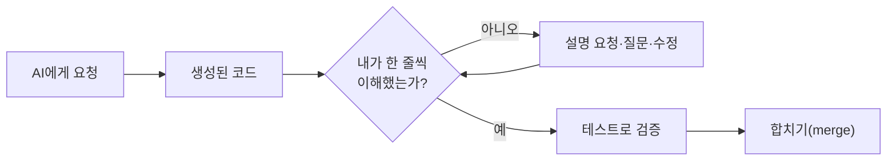

> **대상 독자**: Copilot·Cursor 같은 AI 도구로 코드를 빠르게 만들지만, 프로젝트가 커지면서 "이걸 나중에 어떻게 유지보수하지?"가 걱정되는 분.
>
> 이 글은 **베끼면 바로 쓸 수 있는 템플릿(README·ADR·PR)**까지 포함합니다.

## 1. AI 시대에 유지보수가 더 중요해진 이유

AI 코딩 도구 덕분에 코드 **생산 속도**는 폭발적으로 빨라졌습니다. 그런데 역설적으로, 그래서 **유지보수가 더 어려워졌습니다.** 이유는 세 가지입니다.

1. **이해하지 못한 코드가 쌓인다.** AI가 만든 코드를 완전히 소화하지 못한 채 "일단 되니까" 합치는 일이 잦습니다.
2. **중복이 늘어난다.** 매번 비슷한 코드를 새로 생성하다 보면, 같은 로직이 프로젝트 곳곳에 흩어집니다.
3. **설계 없이 기능만 붙는다.** 큰 그림 없이 요청한 기능만 계속 추가하면 구조가 엉킵니다.

결론은 분명합니다. 이제 사람의 핵심 역량은 **"빠르게 만드는 것"이 아니라 "커진 코드를 오래 관리할 수 있게 설계하고 문서화하는 것"**입니다. AI는 코드를 쓰고, 사람은 **구조를 지킵니다.**

## 2. 초기 설계 — 코드를 짜기 전에 큰 틀부터

코드를 바로 생성하지 말고, 아래 항목을 **한두 쪽짜리 메모**로 먼저 정리하세요. 완벽할 필요는 없지만, **큰 틀이 있어야 AI에게 작업을 맡겨도 방향이 흔들리지 않습니다.**

| 설계 항목 | 정할 내용 | 예시 |
|-----------|-----------|------|
| 목적 | 이 소프트웨어가 **무엇을** 하는가 | "일정을 관리하는 웹 서비스" |
| 사용자/시나리오 | **누가 어떤 상황에서** 쓰는가 | "직장인이 모바일로 일정 등록" |
| 기능 분해 | 기능을 **덩어리**로 나눔 | 로그인 / 일정 CRUD / 알림 |
| 폴더 구조 | 코드를 **어디에** 둘지 | `/api`, `/web`, `/db`, `/shared` |
| 데이터 모델 | 다루는 **데이터의 형태** | 일정 = {제목, 시작, 종료, 반복} |
| 기술 선택 | 언어·프레임워크·DB | React, FastAPI, PostgreSQL |
| 비기능 요구 | 성능·보안·확장성 기준 | "응답 200ms 이내", "비밀번호 해싱" |

### 폴더 구조는 "한 가지 기준"으로

흔한 실수는 폴더를 **일관성 없이** 나누는 것입니다. 보통 두 가지 방식 중 하나를 **골라서 끝까지** 지킵니다.

```text
# 방식 A — 역할(레이어)별          # 방식 B — 기능(도메인)별
src/                               src/
├─ controllers/                    ├─ auth/
├─ services/                       │   ├─ auth.controller
├─ repositories/                   │   ├─ auth.service
└─ models/                         │   └─ auth.model
                                   └─ schedule/
                                       ├─ schedule.controller
                                       └─ schedule.service
```

작은 프로젝트는 방식 A, 기능이 많아지는 프로젝트는 방식 B가 유리한 경우가 많습니다. **중요한 건 섞지 않는 것**입니다.

## 3. 꼭 만들어야 할 문서 7종

문서는 "미래의 나"와 "동료"를 위한 투자입니다. 처음엔 짧게 시작해 점점 채우세요.

1. **README.md** — 프로젝트 소개, 실행 방법, 사용 예시. (가장 기본)
2. **아키텍처 개요** — 전체 구조를 그림 한 장 + 설명으로.
3. **API 명세** — 각 기능의 요청·응답 형식.
4. **데이터베이스 설계(ERD)** — 어떤 데이터를 어떤 표에 저장하는지.
5. **코딩 컨벤션** — 이름 규칙, 폴더 규칙, 포맷 규칙 등 **팀의 약속.**
6. **변경 이력(CHANGELOG)** — 버전별로 무엇이 바뀌었는지.
7. **의사결정 기록(ADR)** — **"왜 이렇게 만들었는지"**를 남기는 짧은 메모.

특히 7번(ADR)은 AI 시대에 가치가 큽니다. 몇 달 뒤 코드만 봐서는 "왜 이 선택을 했는지" 알 수 없기 때문입니다.

### README 템플릿 (복붙용)

```markdown
# 프로젝트 이름
한 줄 소개 (이 프로젝트가 무엇을 하는가)

## 기능
- 핵심 기능 1
- 핵심 기능 2

## 실행 방법
​```bash
git clone <repo>
cd project
npm install
npm run dev
​```

## 사용 예시
(스크린샷 또는 간단한 코드 예시)

## 주요 동작 방식
(핵심 흐름을 2~3줄로 설명)

## 폴더 구조
(중요 폴더가 각각 무슨 역할인지)
```

### ADR 템플릿 (복붙용)

```markdown
# ADR-001: 데이터베이스로 PostgreSQL 선택

## 상태
채택됨 (2026-11-23)

## 배경
일정 데이터에 복잡한 관계와 조건 검색이 필요하다.

## 결정
관계형 DB인 PostgreSQL을 사용한다.

## 이유
- 복잡한 조인·인덱싱에 강하다
- 팀이 이미 익숙하다

## 대안과 트레이드오프
- MongoDB: 스키마 유연하지만 관계 질의에 약함 → 탈락
```

## 4. 유지보수하기 좋은 코드 습관

### (1) 한 가지 책임만 — 작게 쪼개기
함수와 파일은 **한 가지 일**만 하도록 작게 나눕니다. 함수가 화면을 넘어가면 쪼갤 신호입니다. 길수록 버그가 숨습니다.

### (2) 이름이 곧 문서
`data`, `tmp`, `a1` 대신 `userList`, `isLoggedIn`처럼 **역할이 드러나는 이름**을 씁니다. 좋은 이름은 주석을 줄여 줍니다.

### (3) 중복 제거(DRY)
같은 로직이 세 번 이상 반복되면 **공통 함수/모듈로** 묶습니다. 단, 성급한 추상화도 독이므로 "세 번째 반복"을 신호로 삼으세요.

### (4) 의존성 관리
라이브러리는 꼭 필요한 것만, 버전을 고정해(lock 파일) 재현 가능하게 유지합니다. 쓰지 않는 패키지는 정리합니다.

### (5) 테스트로 안전망 만들기
핵심 기능에는 테스트를 붙입니다. 나중에 코드를 고칠 때 **"다른 곳을 망가뜨렸는지"**를 즉시 알 수 있어, 리팩터링이 두렵지 않게 됩니다.

### (6) 기술 부채를 기록하기
급하게 대충 짠 부분은 `// TODO:`나 이슈로 **남겨 두고** 나중에 갚습니다. 보이지 않는 부채가 가장 위험합니다.

## 5. AI가 만든 코드를 안전하게 다루는 법

AI는 **초안 생성기**입니다. 그 결과물을 다루는 원칙을 정리합니다.



- **이해하지 못한 코드는 합치지 않는다.** "일단 되니까"가 가장 위험합니다.
- **AI를 리뷰어로도 쓴다.** "이 코드의 문제점은?", "더 단순하게 바꾼다면?"처럼 되물어 개선점을 얻습니다.
- **보안·비밀값을 조심한다.** AI가 만든 코드에 하드코딩된 키나 안전하지 않은 처리가 없는지 확인합니다.
- **커밋은 작게, 메시지는 명확하게.** 변경 단위를 작게 유지하면 문제가 생겼을 때 되돌리기 쉽습니다.

### PR(Pull Request) 템플릿 (복붙용)

```markdown
## 무엇을 했나요
- 구현/수정한 내용 요약

## 어떻게 테스트했나요
- 재현/확인 방법

## 변경 사항
- 주요 파일·동작 변화

## 체크리스트
- [ ] 생성된 코드를 직접 이해했다
- [ ] 테스트를 통과한다
- [ ] 비밀값이 포함되지 않았다
```

## 6. 정리

- **설계 먼저, 코드는 나중에.** 큰 틀을 정하고 시작하세요.
- **문서는 미래를 위한 투자.** README부터 꾸준히 채우고, "왜"는 ADR에 남기세요.
- **작게·명확하게·중복 없이.** 유지보수의 3원칙입니다.
- **AI는 보조, 검증은 사람.** 이해하지 못한 코드는 절대 합치지 마세요.

AI가 코드를 빨리 만들어 줄수록, 사람은 **구조를 설계하고 지키는 역할**에 더 집중해야 합니다. 그것이 커진 프로젝트를 오래 끌고 가는 유일한 방법입니다.
