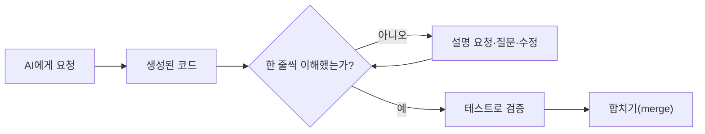

AI 코딩 도구로 코드를 빠르게 찍어낼 수 있게 되면서, 역설적으로 "이걸 나중에 어떻게 유지보수하지?"라는 고민이 더 커졌습니다. 이 글은 프로젝트가 커져도 구조가 무너지지 않도록, 처음에 틀을 어떻게 잡고 무엇을 기록으로 남겨 두면 좋은지 정리한 것입니다. 그대로 복사해 쓸 수 있는 README·ADR·PR 템플릿도 함께 실었습니다.

## 1. 왜 지금 유지보수가 더 까다로워졌나

코드를 **만드는** 속도는 분명히 빨라졌는데, **관리하는** 일은 오히려 어려워졌습니다. 이유는 서로 맞물려 있습니다.

- 끝까지 읽어 보지 않은 코드가 쌓입니다. AI가 내놓은 결과를 완전히 소화하지 못한 채 "일단 되니까" 합치는 일이 잦기 때문입니다.
- 같은 로직이 흩어집니다. 비슷한 코드를 매번 새로 생성하다 보면 중복이 프로젝트 곳곳에 생깁니다.
- 구조가 엉킵니다. 큰 그림 없이 요청한 기능만 계속 붙이면 결국 서로 얽혀 손대기 어려워집니다.

정리하면, 사람이 집중해야 할 일이 "빨리 만드는 것"에서 "오래 관리할 수 있게 설계하고 기록을 남기는 것"으로 옮겨 가고 있습니다. 아래에서는 그 작업을 설계 → 문서 → 코드 습관 → AI 코드 다루기 순서로 살펴봅니다.

## 2. 코드를 짜기 전에: 한두 쪽짜리 설계 메모

바로 코드를 생성하기 전에, 아래 항목을 한두 쪽 분량으로 먼저 적어 두길 권합니다. 완벽할 필요는 없습니다. 큰 틀만 있어도 AI에게 작업을 맡겼을 때 방향이 흔들리지 않습니다.

| 항목 | 정할 내용 | 예시 |
|------|-----------|------|
| 목적 | 이 소프트웨어가 무엇을 하는가 | "일정을 관리하는 웹 서비스" |
| 사용자/시나리오 | 누가 어떤 상황에서 쓰는가 | "직장인이 모바일로 일정 등록" |
| 기능 분해 | 기능을 덩어리로 나눔 | 로그인 / 일정 CRUD / 알림 |
| 폴더 구조 | 코드를 어디에 둘지 | `/api`, `/web`, `/db`, `/shared` |
| 데이터 모델 | 다루는 데이터의 형태 | 일정 = {제목, 시작, 종료, 반복} |
| 기술 선택 | 언어·프레임워크·DB | React, FastAPI, PostgreSQL |
| 비기능 요구 | 성능·보안·확장성 기준 | "응답 200ms 이내", "비밀번호 해싱" |

폴더 구조를 나눌 때 가장 흔한 실수는 기준을 섞는 것입니다. 보통은 아래 두 방식 중 하나를 골라 끝까지 지킵니다.

```text
# 방식 A — 역할(레이어)별          # 방식 B — 기능(도메인)별
src/                               src/
├─ controllers/                    ├─ auth/
├─ services/                       │   ├─ auth.controller
├─ repositories/                   │   ├─ auth.service
└─ models/                         │   └─ auth.model
                                   └─ schedule/
                                       ├─ schedule.controller
                                       └─ schedule.service
```

규모가 작을 때는 방식 A가, 기능이 많아지는 프로젝트에서는 방식 B가 편한 경우가 많습니다. 어느 쪽을 고르든 중요한 것은 두 기준을 섞지 않는 것입니다.

## 3. 남겨 두면 좋은 문서

문서는 몇 달 뒤의 자신과 동료를 위한 투자입니다. 처음부터 완성할 필요는 없고, 짧게 시작해 조금씩 채워 나가면 됩니다. 아래 순서는 중요도에 가깝습니다.

1. **README** — 프로젝트 소개, 실행 방법, 사용 예시. 가장 먼저 만들어야 할 문서입니다.
2. **아키텍처 개요** — 전체 구조를 그림 한 장과 짧은 설명으로.
3. **API 명세** — 각 기능의 요청·응답 형식.
4. **데이터베이스 설계(ERD)** — 어떤 데이터를 어떤 표에 저장하는지.
5. **코딩 컨벤션** — 이름·폴더·포맷 규칙 같은 팀의 약속.
6. **변경 이력(CHANGELOG)** — 버전별로 무엇이 바뀌었는지.
7. **의사결정 기록(ADR)** — "왜 이렇게 만들었는지"를 짧게 남기는 메모.

마지막 ADR은 특히 가치가 큽니다. 시간이 지나면 코드만 봐서는 "왜 이 선택을 했는지"를 알 수 없고, 그 맥락을 모른 채 고치다 보면 같은 고민을 반복하게 되기 때문입니다.

아래는 그대로 가져다 쓸 수 있는 README와 ADR 템플릿입니다.

```markdown
# 프로젝트 이름
한 줄 소개 (이 프로젝트가 무엇을 하는가)

## 기능
- 핵심 기능 1
- 핵심 기능 2

## 실행 방법
​```bash
git clone <repo>
cd project
npm install
npm run dev
​```

## 사용 예시
(스크린샷 또는 간단한 코드 예시)

## 주요 동작 방식
(핵심 흐름을 2~3줄로 설명)

## 폴더 구조
(중요 폴더가 각각 무슨 역할인지)
```

```markdown
# ADR-001: 데이터베이스로 PostgreSQL 선택

## 상태
채택됨 (2026-11-23)

## 배경
일정 데이터에 복잡한 관계와 조건 검색이 필요하다.

## 결정
관계형 DB인 PostgreSQL을 사용한다.

## 이유
- 복잡한 조인·인덱싱에 강하다
- 팀이 이미 익숙하다

## 대안과 트레이드오프
- MongoDB: 스키마는 유연하지만 관계 질의에 약함 → 탈락
```

## 4. 유지보수하기 좋은 코드 습관

큰 틀을 잡았다면, 실제 코드를 쓸 때 지키면 좋은 습관들이 있습니다.

**한 가지 책임만 맡기기.** 함수와 파일은 한 가지 일만 하도록 작게 나눕니다. 함수가 화면 한 쪽을 넘어가면 쪼갤 신호로 보면 됩니다. 길어질수록 그 안에 버그가 숨기 쉽습니다.

**이름으로 설명하기.** `data`, `tmp`, `a1` 대신 `userList`, `isLoggedIn`처럼 역할이 드러나는 이름을 씁니다. 이름이 좋으면 설명하는 주석이 줄어듭니다.

**중복은 세 번째에 묶기.** 같은 로직이 세 번 이상 반복되면 공통 함수나 모듈로 묶습니다. 다만 한두 번 보고 성급히 추상화하면 오히려 복잡해지므로, "세 번째 반복"을 신호로 삼는 편이 안전합니다.

**의존성 줄이기.** 라이브러리는 꼭 필요한 것만 쓰고, 버전을 lock 파일로 고정해 어디서든 같은 결과가 나오게 합니다. 쓰지 않는 패키지는 그때그때 정리합니다.

**테스트로 안전망 만들기.** 핵심 기능에 테스트를 붙여 두면, 나중에 코드를 고칠 때 다른 곳이 망가졌는지 바로 알 수 있어 리팩터링이 두렵지 않습니다.

**기술 부채는 눈에 보이게.** 급하게 대충 짠 부분은 `// TODO:`나 이슈로 남겨 두고 나중에 갚습니다. 기록되지 않은 부채가 가장 위험합니다.

## 5. AI가 쓴 코드를 안전하게 합치기

AI는 초안을 빠르게 내주는 도구입니다. 그 결과물을 다룰 때의 흐름은 대체로 이렇습니다.



핵심은 이해하지 못한 코드를 합치지 않는 것입니다. "일단 되니까"가 나중에 가장 큰 비용으로 돌아옵니다. 반대로 AI를 리뷰어로 되쓰는 것도 유용합니다. "이 코드의 문제점은?", "더 단순하게 바꾼다면?"처럼 되물으면 개선점을 얻을 수 있습니다. 합치기 전에는 하드코딩된 키나 안전하지 않은 처리가 섞이지 않았는지 확인하고, 커밋은 작게 나눠 문제가 생겼을 때 쉽게 되돌릴 수 있게 둡니다.

팀으로 작업한다면 PR에 아래 정도의 틀을 두면 리뷰가 수월해집니다.

```markdown
## 무엇을 했나요
- 구현/수정한 내용 요약

## 어떻게 테스트했나요
- 재현/확인 방법

## 변경 사항
- 주요 파일·동작 변화

## 체크리스트
- [ ] 생성된 코드를 직접 이해했다
- [ ] 테스트를 통과한다
- [ ] 비밀값이 포함되지 않았다
```

## 6. 요약

- 코드보다 설계를 먼저 정합니다. 한두 쪽짜리 메모면 충분합니다.
- 문서는 짧게 시작해 꾸준히 채우고, 특히 "왜"는 ADR에 남깁니다.
- 코드는 작게·명확하게·중복 없이 유지합니다.
- AI가 쓴 코드는 반드시 사람이 이해하고 검증한 뒤 합칩니다.

코드를 만드는 일이 빨라질수록, 그 코드를 오래 끌고 갈 수 있게 받치는 작업의 비중이 커집니다. 설계와 문서는 그 받침대입니다.
