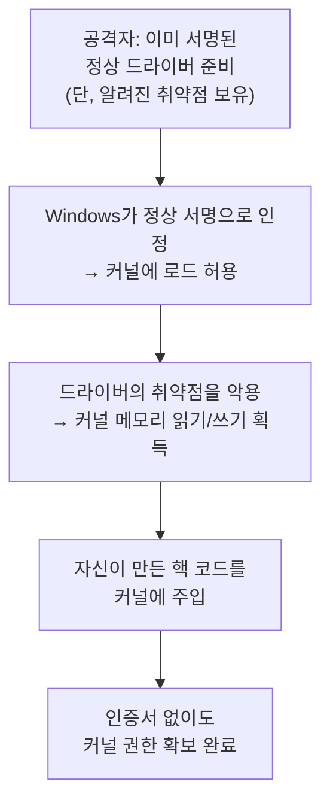

# 유저모드에서 커널 드라이버를 악용하는 핵과 안티치트의 한계, 그리고 대응 방안

> 주제: 서명된(인증서가 있는) 정상 드라이버의 취약점을 악용해 **인증서 없이도 커널에 핵을 심는** BYOVD 기법과, Vanguard(VGC) 같은 커널 안티치트가 흔들리는 이유, 그리고 보완 방법.
>
> ⚠️ 본 글은 **방어·보안 이해를 위한 개념 설명**입니다. 핵 제작 방법이나 우회 코드는 다루지 않습니다.

## 1. 배경: 커널 모드 드라이버가 왜 중요한가

Windows는 권한을 크게 두 영역으로 나눕니다.

- **유저 모드(User Mode):** 일반 프로그램이 도는 공간. 권한이 제한적입니다.
- **커널 모드(Kernel Mode):** 운영체제의 핵심이 도는 공간. **메모리 전체에 접근**할 수 있는 최고 권한입니다.

게임 핵(치트)과 안티치트는 바로 이 **커널 모드를 두고 경쟁**합니다. 커널에 자리 잡으면 **게임 메모리를 읽고 조작**할 수 있고, 반대로 안티치트도 커널에 있어야 그런 핵을 **감시**할 수 있기 때문입니다.

원래 커널 모드 드라이버를 로드하려면 Microsoft의 **코드 서명 인증서**가 필요합니다. 그런데 공격자는 이 **인증서 발급 과정을 건너뛰는** 방법을 찾아냈습니다. 그것이 BYOVD입니다.

## 2. BYOVD란 무엇인가 (핵심 원리)

**BYOVD(Bring Your Own Vulnerable Driver, 취약한 드라이버 가져오기)**는 다음과 같은 흐름으로 동작합니다.

핵심은 이것입니다. **공격자가 직접 서명받을 필요가 없습니다.** 이미 **정식으로 서명되어 있지만 보안 허점이 있는** 남의 드라이버를 빌려 와서, 그 허점을 지렛대 삼아 커널에 들어가는 것입니다.

> 이 기법은 원래 게임 핵보다 **보안 솔루션(백신·EDR)을 무력화**하는 데 더 많이 쓰였습니다. 예를 들어 2024년 Akira·Qilin 랜섬웨어 조직이 Zemana 드라이버의 취약점(CVE-2024-1853 등)을 악용해 EDR을 꺼 버린 사례가 있습니다. 같은 원리가 게임 핵에도 그대로 적용됩니다.

## 3. 왜 Vanguard(VGC) 같은 안티치트가 흔들리는가

Riot의 **Vanguard(서비스 이름 VGC, 드라이버 vgk.sys)**는 **PC 부팅 시점부터** 커널에서 동작하는 강력한 안티치트입니다. 그런데도 BYOVD 앞에서 완벽하지 않은 이유가 있습니다.

1. **로딩 순서의 틈:** 취약 드라이버가 **안티치트보다 먼저** 로드되어 커널에 핵을 심고 **스스로 빠져나가면**, 나중에 켜진 안티치트는 "이미 사라진" 그 흔적을 보기 어렵습니다.
2. **정상 서명이라 차단 명분이 약함:** 문제의 드라이버는 **정식 서명**을 갖고 있어, 무작정 막으면 정상 사용자에게 피해가 갈 수 있습니다.
3. **끝없는 취약 드라이버 목록:** 세상에는 서명됐지만 허점이 있는 드라이버가 **수백 개** 존재합니다(LOLDrivers 프로젝트 참고). 하나를 막으면 다른 하나가 쓰입니다.

즉, 안티치트가 제 기능을 못 하는 근본 원인은 "안티치트가 약해서"가 아니라, **Windows가 정상 서명된 드라이버를 신뢰할 수밖에 없는 구조** 때문입니다.

## 4. 어떻게 보완할 수 있을까 (대응 방안)

### (1) 취약 드라이버 차단 목록 (Blocklist)
Microsoft는 **알려진 취약 드라이버의 차단 목록(Vulnerable Driver Blocklist)**을 운영합니다. 이 목록에 오른 드라이버는 로드가 거부됩니다. 안티치트도 자체 차단 목록을 함께 운영합니다.
- **한계:** 목록은 **이미 알려진** 드라이버만 막습니다. 새로 발견되는 취약 드라이버에는 뒤늦게 대응하게 됩니다.

### (2) HVCI / 메모리 무결성 (가장 효과적인 축)
**HVCI(하이퍼바이저 기반 코드 무결성)**와 **VBS(가상화 기반 보안)**를 켜면, 커널에서 실행되는 코드를 **하이퍼바이저가 검증**합니다. 서명되지 않았거나 변조된 코드는 커널에서 실행되지 못합니다.
- 중요한 점: **VBS를 켜면 Microsoft의 취약 드라이버 차단 목록이 자동으로 함께 활성화**됩니다.
- **부작용:** 일부 **구형 주변기기 드라이버**가 호환되지 않아 동작을 멈출 수 있습니다. 이것이 HVCI 보급이 느린 이유 중 하나입니다.

### (3) 런타임 드라이버 검증 (Runtime Attestation)
최신 안티치트는 **"부팅 이후 로드된 모든 드라이버의 기록"**을 남기는 기법(Runtime Driver Attestation Report 등)을 도입하고 있습니다. 이렇게 하면 안티치트가 **나중에 켜졌더라도**, 자신이 꺼져 있던 동안 끼어든 드라이버를 **사후에 추적**할 수 있습니다. 이는 3장에서 말한 "로딩 순서의 틈"을 메우는 방향입니다.

### (4) 하드웨어 기반 보안 요구
TPM 2.0, **Secure Boot**, IOMMU 등을 요구하면 부팅 단계부터 신뢰 사슬이 형성되어, 부팅 초기에 끼어드는 공격이 어려워집니다. 실제로 Riot은 2026년 6월 **Vanguard On-Demand** 모드를 발표하면서, 이를 쓰려면 Windows 11 25H2와 함께 **TPM 2.0·Secure Boot·VBS·HVCI·IOMMU**를 모두 요구하도록 했습니다. 보안을 강화하는 대신 사용 조건이 까다로워진 것입니다.

### (5) 서버 측 탐지 보강
클라이언트(커널) 방어만으로는 한계가 있으므로, **서버에서 플레이 데이터의 이상 패턴**(비정상적인 에임 궤적, 벽 너머 정보 활용 등)을 **통계·AI로 탐지**하는 방식을 병행하는 것이 점점 중요해지고 있습니다. 클라이언트가 뚫려도 **서버는 속이기 어렵기** 때문입니다.

## 5. 대응 방안 정리

| 대응 | 효과 | 한계 |
|------|------|------|
| 취약 드라이버 차단 목록 | 알려진 위협 즉시 차단 | 신종에는 사후 대응 |
| HVCI / VBS | 커널 코드 변조 원천 차단 (**가장 효과적**) | 구형 드라이버 호환 문제 |
| 런타임 드라이버 검증 | "로딩 순서의 틈" 보완 | 완전한 차단은 아님 |
| 하드웨어 보안 요구 | 부팅 단계부터 신뢰 확보 | 사용자 진입 장벽 상승 |
| 서버 측 이상 탐지 | 클라이언트가 뚫려도 탐지 | 오탐·지연 가능성 |

## 6. 결론

BYOVD 문제의 본질은 **"정상 서명된 드라이버를 신뢰하는 Windows의 구조"**에 있습니다. 따라서 단일 대책만으로는 해결되지 않으며, **① 취약 드라이버 차단 목록 + ② HVCI 기반 커널 보호 + ③ 런타임 검증 + ④ 하드웨어 신뢰 사슬 + ⑤ 서버 측 AI 탐지**를 **여러 겹으로 쌓는 다층 방어(Defense in Depth)**가 현실적인 해법입니다.

특히 **HVCI(메모리 무결성)**를 켜는 것이 가장 효과가 크며, 앞으로의 안티치트는 "클라이언트에서 모든 것을 막겠다"는 접근에서 **"뚫릴 수 있음을 전제로, 서버에서 탐지한다"**는 방향으로 무게 중심을 옮겨 가고 있습니다.

## 참고 자료
- [Cisco Talos — 취약한 Windows 드라이버 탐구](https://blog.talosintelligence.com/exploring-vulnerable-windows-drivers/)
- [Bitdefender — BYOVD란 무엇인가](https://techzone.bitdefender.com/en/tech-explainers/what-is-bring-your-own-vulnerable-driver--byovd-.html)
- [Check Point Research — 취약 드라이버 조사와 완화](https://research.checkpoint.com/2024/breaking-boundaries-investigating-vulnerable-drivers-and-mitigating-risks/)
- [Tom's Hardware — Vanguard On-Demand 모드 (2026)](https://www.tomshardware.com/video-games/pc-gaming/riot-vanguard-adds-an-on-demand-mode-that-stops-anti-cheat-loading-at-boot-on-secured-windows-11-pcs)
- [CrowdStrike — 실제 침해에서의 취약 드라이버 공격 방어](https://crowdstrike.com/en-us/blog/falcon-prevents-vulnerable-driver-attacks-real-world-intrusion)
