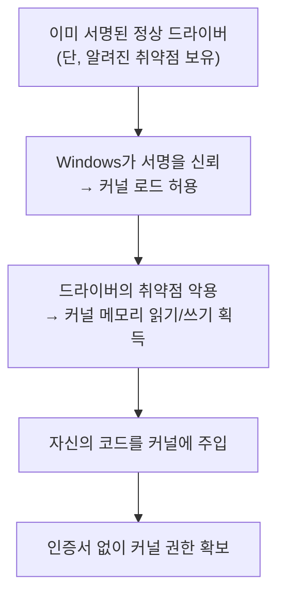

이 글은 유저 모드에서 커널 드라이버의 취약점을 악용해 인증서 없이 커널에 코드를 심는 BYOVD 기법이 무엇이고, 커널 안티치트가 이를 완전히 막지 못하는 이유는 무엇이며, 어떻게 방어하는지를 개념 수준에서 설명합니다. 핵 제작 방법이나 우회 코드는 다루지 않고, 방어와 구조 이해에 초점을 둡니다.

## 1. 배경 — 유저 모드와 커널 모드

Windows는 권한을 두 영역으로 나눕니다. 유저 모드(user mode)는 일반 프로그램이 도는 공간으로 권한이 제한적이고, 커널 모드(kernel mode)는 운영체제 핵심이 도는 공간으로 메모리 전체에 접근할 수 있는 최고 권한을 가집니다.

게임 핵과 안티치트는 이 커널 모드를 두고 경쟁합니다. 커널에 자리 잡으면 게임 메모리를 읽고 조작할 수 있고, 안티치트도 커널에 있어야 그런 핵을 감시할 수 있기 때문입니다. 원래 커널 드라이버를 로드하려면 Microsoft의 코드 서명 인증서가 필요한데, 공격자는 이 인증서 발급을 건너뛰는 방법을 찾아냈습니다. 그것이 BYOVD입니다.

## 2. BYOVD — 남의 서명을 빌린다

BYOVD(Bring Your Own Vulnerable Driver, 취약한 드라이버 가져오기)의 흐름은 다음과 같습니다.

핵심은 공격자가 직접 서명을 받을 필요가 없다는 점입니다. 이미 정식으로 서명됐지만 허점이 있는 남의 드라이버를 가져와, 그 허점을 지렛대 삼아 커널에 들어갑니다.

이 기법은 원래 게임 핵보다 보안 솔루션(백신·EDR)을 무력화하는 데 더 많이 쓰였습니다. 2024년 Akira·Qilin 랜섬웨어가 Zemana 드라이버 취약점(CVE-2024-1853 등)으로 EDR을 꺼 버린 사례가 대표적입니다. 같은 원리가 게임 핵에도 그대로 적용됩니다.

## 3. 왜 커널 안티치트가 흔들리나

Riot의 Vanguard(vgk.sys), Epic의 Easy Anti-Cheat(EAC), BattlEye 같은 커널 안티치트가 BYOVD 앞에서 완벽하지 못한 데는 구조적 이유가 있습니다.

첫째, 로딩 순서의 틈입니다. 취약 드라이버가 안티치트보다 먼저 로드되어 코드를 심고 스스로 빠져나가면, 나중에 켜진 안티치트는 이미 사라진 흔적을 보기 어렵습니다. 둘째, 문제의 드라이버가 정식 서명을 가지고 있어 무작정 막으면 정상 사용자에게 피해가 갑니다. 셋째, 서명됐지만 허점이 있는 드라이버가 수백 개 존재하므로(LOLDrivers 프로젝트) 하나를 막아도 다른 하나가 쓰입니다.

근본 원인은 안티치트가 약해서가 아니라, Windows가 정상 서명된 드라이버를 신뢰할 수밖에 없는 구조 때문입니다.

| 안티치트 | 커널 상주 | 특징 |
|----------|-----------|------|
| Vanguard | 상시(부팅 시) | 가장 강력, 드라이버 허용목록 운영. 2026년 On-Demand 모드 도입 |
| EAC (Epic) | 플레이 중 | 가장 많은 게임이 채택 |
| BattlEye | 플레이 중 | 다수 FPS에서 사용 |

## 4. 다층 방어

단일 대책으로는 해결되지 않습니다. 여러 겹으로 쌓는 다층 방어(defense in depth)가 현실적인 해법이며, 아래 다섯 가지가 서로를 보완합니다.

**취약 드라이버 차단 목록(blocklist).** Microsoft와 안티치트가 알려진 취약 드라이버의 로드를 거부합니다. 다만 이미 알려진 것만 막을 수 있어 신종에는 사후 대응이 됩니다.

**HVCI / 메모리 무결성.** HVCI(하이퍼바이저 기반 코드 무결성)와 VBS(가상화 기반 보안)를 켜면 커널에서 실행되는 코드를 하이퍼바이저가 검증해, 서명되지 않았거나 변조된 코드는 커널에서 실행되지 못합니다. VBS를 켜면 Microsoft의 취약 드라이버 차단 목록도 자동으로 함께 활성화됩니다. 다층 방어 중 효과가 가장 크지만, 일부 구형 주변기기 드라이버가 호환되지 않아 멈출 수 있다는 부작용이 있어 보급이 더딘 편입니다.

**런타임 드라이버 검증(runtime attestation).** 최신 안티치트는 부팅 이후 로드된 모든 드라이버의 기록을 남깁니다. 안티치트가 나중에 켜졌더라도 자신이 꺼져 있던 동안 끼어든 드라이버를 사후에 추적할 수 있어, 앞서 말한 로딩 순서의 틈을 메웁니다.

**하드웨어 기반 신뢰.** TPM 2.0, Secure Boot, IOMMU를 요구하면 부팅 단계부터 신뢰 사슬이 형성됩니다. 실제로 Riot은 2026년 6월 게임 실행 시에만 드라이버를 로드하는 Vanguard On-Demand를 발표하면서, Windows 11 25H2와 TPM 2.0·Secure Boot·VBS·HVCI·IOMMU를 모두 요구하도록 했습니다. 보안을 높인 대신 사용 조건이 까다로워진 셈입니다.

**서버 측 이상 탐지.** 클라이언트(커널) 방어만으로는 한계가 있어, 서버에서 플레이 데이터의 이상 패턴(비정상 에임 궤적, 벽 너머 정보 활용 등)을 통계·AI로 탐지하는 방식이 중요해지고 있습니다. 클라이언트가 뚫려도 서버는 속이기 어렵기 때문입니다.

| 대응 | 효과 | 한계 |
|------|------|------|
| 취약 드라이버 차단 목록 | 알려진 위협 즉시 차단 | 신종엔 사후 대응 |
| HVCI / VBS | 커널 코드 변조 원천 차단(효과 최상) | 구형 드라이버 호환 문제 |
| 런타임 드라이버 검증 | 로딩 순서의 틈 보완 | 완전 차단은 아님 |
| 하드웨어 신뢰 | 부팅 단계부터 신뢰 | 사용자 진입 장벽 상승 |
| 서버 측 이상 탐지 | 클라이언트 뚫려도 탐지 | 오탐·지연 가능성 |

## 5. 정리

BYOVD의 본질은 정상 서명된 드라이버를 신뢰할 수밖에 없는 Windows의 구조에 있습니다. 그래서 차단 목록, HVCI 커널 보호, 런타임 검증, 하드웨어 신뢰, 서버 측 탐지를 겹겹이 쌓는 수밖에 없습니다. 이 중 HVCI(메모리 무결성)의 효과가 가장 크고, 안티치트의 무게 중심은 "클라이언트에서 모두 막는다"에서 "뚫릴 수 있음을 전제로 서버에서 탐지한다"로 옮겨 가고 있습니다.

## 참고 자료
- [Cisco Talos — 취약한 Windows 드라이버 탐구](https://blog.talosintelligence.com/exploring-vulnerable-windows-drivers/)
- [Bitdefender — BYOVD란 무엇인가](https://techzone.bitdefender.com/en/tech-explainers/what-is-bring-your-own-vulnerable-driver--byovd-.html)
- [Tom's Hardware — Vanguard On-Demand 모드(2026)](https://www.tomshardware.com/video-games/pc-gaming/riot-vanguard-adds-an-on-demand-mode-that-stops-anti-cheat-loading-at-boot-on-secured-windows-11-pcs)
- [LOLDrivers — 알려진 취약·악성 드라이버 목록](https://www.loldrivers.io/)
