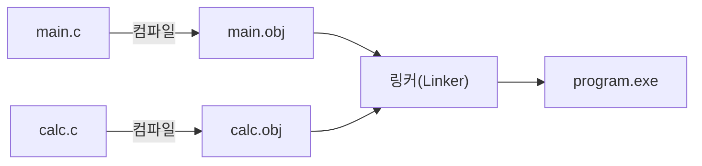

> **대상 독자**: Visual Studio로 C언어를 배우는 입문자. `main.c` 하나에 모든 코드를 넣다가, 파일을 어떻게 나눠야 할지 막막한 분.
>
> 이 글을 끝까지 따라오면 **왜 나누는지**, **무엇을 `.h`에 두고 무엇을 `.c`에 둘지**, 그리고 `extern`·`static`·인클루드 가드를 **스스로 판단해서 쓸 수 있게** 됩니다.

## 1. 왜 파일을 나눠야 할까? — "번역 단위"라는 개념

처음에는 모든 코드를 `main.c` 하나에 몰아넣어도 잘 돌아갑니다. 하지만 코드가 수백 줄이 되면 이런 문제가 생깁니다.

- 함수 하나를 고치려 해도 **어디 있는지 찾기** 어렵습니다.
- 같은 기능을 다른 프로젝트에서 **재사용**할 수 없습니다.
- 팀으로 작업하면 한 파일을 여러 명이 건드려 **충돌**이 납니다.
- 파일 하나만 바꿔도 **전체를 다시 컴파일**해야 합니다.

C언어의 컴파일은 **파일(.c) 단위**로 이루어집니다. 컴파일러는 `.c` 파일 하나를 **번역 단위(Translation Unit)**라고 부르는 독립된 덩어리로 보고, 각각 따로 `.obj`(오브젝트 파일)로 번역합니다. 그 후 **링커(Linker)**가 이 오브젝트 파일들을 하나로 이어 붙여 최종 실행 파일을 만듭니다.



이 구조를 이해하는 것이 핵심입니다. **"컴파일은 파일별로 따로, 연결은 링커가 한 번에"** — 뒤에 나오는 `extern`과 링커 오류가 모두 여기서 출발합니다.

## 2. 가장 중요한 원칙 — 선언과 정의를 구분하라

C언어 구조 분리의 90%는 이 한 문장으로 끝납니다.

> **선언(declaration)은 헤더 파일(.h)에, 정의(definition)는 소스 파일(.c)에 둔다.**

| 구분 | 뜻 | 예시 |
|------|----|----|
| 선언 | "이런 게 **있다**"고 알려주기 (실체 없음) | `int add(int a, int b);` |
| 정의 | 실제 **내용/실체**를 만들기 | `int add(int a, int b) { return a + b; }` |

비유하면, **헤더(.h)는 메뉴판**이고 **소스(.c)는 주방**입니다. 메뉴판에는 "무엇을 파는지"만 적고, 실제 조리는 주방에서 합니다. 손님(다른 파일)은 메뉴판만 보면 주문할 수 있습니다.

선언은 **여러 번 해도** 괜찮지만, 정의는 프로그램 전체에서 **딱 한 번만** 있어야 합니다. 이것을 **단일 정의 규칙(One Definition Rule)**이라고 합니다. 이 규칙을 어기면 바로 뒤에서 볼 "중복 정의" 링커 오류가 납니다.

## 3. 헤더 파일 설계 — 인클루드 가드는 필수

헤더 파일에는 보통 **함수 선언, 매크로, 구조체 정의, 타입 정의**를 넣습니다. 이때 반드시 **인클루드 가드**를 써야 합니다.

```c
// calc.h
#ifndef CALC_H     // CALC_H가 아직 정의되지 않았다면
#define CALC_H     // CALC_H를 정의하고 아래 내용을 포함한다

int add(int a, int b);
int sub(int a, int b);

#endif // CALC_H
```

### 인클루드 가드가 왜 필요한가?

헤더는 여러 파일에서 `#include` 됩니다. 만약 `a.h`가 `calc.h`를 포함하고, `main.c`가 `a.h`와 `calc.h`를 둘 다 포함하면, `calc.h`의 내용이 **두 번 복사**되어 "중복 정의" 오류가 납니다. 인클루드 가드는 **"이미 한 번 포함했으면 두 번째부터는 건너뛰어라"**라는 안전장치입니다.

Visual Studio를 비롯한 대부분의 컴파일러는 더 간단한 방법도 지원합니다.

```c
// calc.h
#pragma once      // 이 파일은 한 번만 포함하라 (한 줄로 끝)

int add(int a, int b);
int sub(int a, int b);
```

`#pragma once`는 짧고 편하지만 **표준이 아닙니다**(다만 사실상 모든 주요 컴파일러가 지원). 이식성을 최우선으로 한다면 `#ifndef` 방식을, 편의성을 원하면 `#pragma once`를 쓰면 됩니다. 둘을 **같이 쓰지는 마세요** — 하나면 충분합니다.

## 4. 함수 분리 — 가장 기본 예제

덧셈·뺄셈 기능을 별도 파일로 분리해 보겠습니다. 파일은 3개입니다.

```c
// calc.h  ── 선언 (메뉴판)
#pragma once
int add(int a, int b);
int sub(int a, int b);
```

```c
// calc.c  ── 정의 (주방)
#include "calc.h"           // 자기 선언을 먼저 포함해 일치 여부를 검사

int add(int a, int b) {
    return a + b;
}
int sub(int a, int b) {
    return a - b;
}
```

```c
// main.c  ── 사용하는 쪽
#include <stdio.h>
#include "calc.h"           // calc.c가 아니라 calc.h를 포함한다!

int main(void) {
    printf("3 + 2 = %d\n", add(3, 2));
    printf("3 - 2 = %d\n", sub(3, 2));
    return 0;
}
```

여기서 꼭 기억할 두 가지입니다.

1. `main.c`는 `calc.c`를 **포함하지 않습니다.** 오직 `calc.h`(메뉴판)만 포함합니다. 실제 코드는 링커가 `calc.obj`에서 찾아 연결해 줍니다.
2. `#include "내 헤더"`는 **큰따옴표**, `#include <표준 헤더>`는 **꺾쇠**를 씁니다. 큰따옴표는 "내 프로젝트 폴더부터 찾아라", 꺾쇠는 "시스템 폴더에서 찾아라"라는 의미입니다.

## 5. 여러 파일에서 변수를 공유하기 — `extern`

함수뿐 아니라 **전역 변수**도 여러 파일에서 함께 쓰고 싶을 때가 있습니다. 예를 들어 게임의 "현재 점수"를 여러 파일이 읽고 써야 한다고 해 봅시다. 이때 쓰는 것이 `extern`입니다.

`extern`의 핵심 규칙은 이렇습니다.

> 전역 변수는 **정확히 한 개의 `.c` 파일에서 정의**하고, 그 변수를 쓰려는 **다른 모든 파일에서는 `extern`으로 선언**한다.

```c
// game_state.h  ── extern "선언"만 둔다 (메모리를 만들지 않음)
#pragma once
extern int g_score;        // "g_score라는 int가 어딘가에 있다"고 알림
void add_score(int p);
```

```c
// game_state.c  ── 실제 "정의" (메모리를 여기서 딱 한 번 만든다)
#include "game_state.h"

int g_score = 0;           // 진짜 정의 (extern 없이, 여기 단 한 곳)

void add_score(int p) {
    g_score += p;
}
```

```c
// main.c
#include <stdio.h>
#include "game_state.h"    // extern 선언을 가져옴

int main(void) {
    add_score(10);
    add_score(5);
    printf("점수: %d\n", g_score);   // 15
    return 0;
}
```

### `extern`을 이해하는 핵심 포인트

- `extern int g_score;`는 **"선언"**입니다. 메모리를 만들지 않고, 그저 "이 변수는 다른 파일에 있다"고 컴파일러에게 알립니다. 그래서 **여러 파일(헤더)에 들어가도 안전**합니다.
- `int g_score = 0;`은 **"정의"**입니다. 이 줄이 실제로 메모리를 할당합니다. 그래서 **단 하나의 `.c`에만** 있어야 합니다.
- ⚠️ **흔한 실수**: `extern int g_score = 0;`처럼 `extern`을 붙인 채 **값으로 초기화**하면, 컴파일러는 이를 "정의"로 취급합니다. 이러면 정의가 두 곳이 되어 "중복 정의" 오류가 납니다. `extern`에는 **절대 초깃값을 주지 마세요.**

## 6. 파일 안에서만 쓰기 — `static` (내부 링크)

`extern`의 반대가 `static`입니다. 전역 변수나 함수 앞에 `static`을 붙이면, **그 변수/함수는 자신이 선언된 `.c` 파일 안에서만** 보이고, 다른 파일에서는 접근할 수 없게 됩니다. 이것을 **내부 링크(internal linkage)**라고 합니다.

```c
// logger.c
static int s_log_count = 0;      // 이 파일 전용. 다른 파일은 못 본다.

static void write_line(const char* msg) {   // 이 파일 전용 도우미 함수
    s_log_count++;
    // ... 실제 출력 ...
}

void log_info(const char* msg) {  // 이건 static이 아니므로 외부 공개
    write_line(msg);
}
```

### 언제 `static`을 쓰나?

- 다른 파일에 **보여줄 필요가 없는 내부 전용 변수/함수**에 붙입니다.
- 이렇게 하면 **이름 충돌을 막고**, "이건 내부 구현일 뿐"이라는 의도를 코드로 표현할 수 있습니다.
- 규칙으로 기억하세요: **"밖에 공유할 전역은 `extern`(+ 한 곳의 정의), 파일 안에서만 쓸 전역은 `static`."**

> 참고로 함수 안에서 쓰는 `static 지역 변수`는 의미가 조금 다릅니다. 이 경우 `static`은 "함수가 끝나도 값이 사라지지 않고 유지된다"는 뜻입니다. (예: 호출 횟수 세기) 같은 키워드지만 **전역에 붙을 때(링크 범위 제한)**와 **지역에 붙을 때(수명 연장)**의 역할이 다르다는 점만 알아 두세요.

## 7. 자주 만나는 링커·컴파일 오류와 해결법

구조를 나누기 시작하면 아래 오류를 반드시 마주칩니다. 미리 알아 두면 당황하지 않습니다.

| 오류 코드 | 뜻 | 원인과 해결 |
|-----------|----|-----------|
| **C1083** | `cannot open include file` | 헤더 경로가 틀림. `#include` 파일명·경로 확인, 큰따옴표/꺾쇠 구분 |
| **LNK2019** | `unresolved external symbol` | **선언만 있고 정의가 없음.** 함수 몸통을 안 만들었거나, 해당 `.c`가 프로젝트에 빠짐 |
| **LNK2005** | `already defined` (중복 정의) | **정의가 두 번** 있음. 헤더에 함수 몸통/변수 정의를 넣었거나, `extern`에 초깃값을 줬거나, 가드를 빠뜨림 |

가장 헷갈리는 건 **LNK2019(정의 없음)**와 **LNK2005(정의 중복)**입니다. 기억하기 쉽게 정리하면,

- **정의가 모자라면** → LNK2019 (→ 해당 `.c` 파일을 프로젝트에 추가했는지 확인)
- **정의가 넘치면** → LNK2005 (→ 헤더에 실제 코드를 넣지 않았는지, 인클루드 가드가 있는지 확인)

## 8. Visual Studio에서 직접 해보기

1. 솔루션 탐색기에서 프로젝트 이름을 **마우스 오른쪽 클릭** → **추가 → 새 항목**.
2. **헤더 파일(.h)**을 골라 `calc.h` 생성, **C++ 파일(.cpp)**을 골라 이름을 `calc.c`로 바꿔 생성.
   - ⚠️ 확장자를 `.cpp`로 두면 **C++로 컴파일**됩니다. 순수 C로 작성하려면 반드시 `.c`로 저장하세요.
3. `.c` 파일을 새로 추가하면 Visual Studio가 자동으로 프로젝트에 포함해 함께 컴파일합니다. (이 과정을 빠뜨리면 LNK2019가 납니다.)
4. **Ctrl + F7**로 파일 하나만 컴파일해 보고, **F7**(빌드)로 전체를 연결해 보세요.

## 9. 한눈에 보는 체크리스트

입문자가 이것만 지켜도 구조가 깔끔해집니다.

- [ ] 하나의 파일은 **하나의 역할**만 맡는다. (계산은 `calc.c`, 로그는 `logger.c`)
- [ ] **선언은 `.h`, 정의는 `.c`**에 둔다.
- [ ] 모든 헤더에 **인클루드 가드(`#pragma once` 또는 `#ifndef`)**를 넣는다.
- [ ] 헤더에는 **함수 몸통이나 변수 정의를 넣지 않는다.** (선언만)
- [ ] 공유 전역 변수는 **헤더에 `extern` 선언 + 한 `.c`에 정의**.
- [ ] 파일 내부 전용 변수/함수에는 **`static`**을 붙인다.
- [ ] `.c`는 자신의 짝 헤더를 **가장 먼저 `#include`** 한다. (선언과 정의 불일치를 조기에 발견)

처음에는 번거로워 보여도, 이 습관이 몸에 배면 코드가 수천 줄로 늘어나도 길을 잃지 않습니다. 작은 예제부터 직접 파일을 나눠 보며 손에 익히세요.

## 참고 자료
- [Microsoft Learn — extern을 사용하여 링크 지정](https://learn.microsoft.com/ko-kr/previous-versions/0603949d(v=vs.120))
- [C/C++ extern, static 정리 (velog)](https://velog.io/@kjh3865/ExternAndStatic)
- [C언어 파일의 분할과 헤더 파일 디자인 (velog)](https://velog.io/@mingming_eee/c-4-27)
