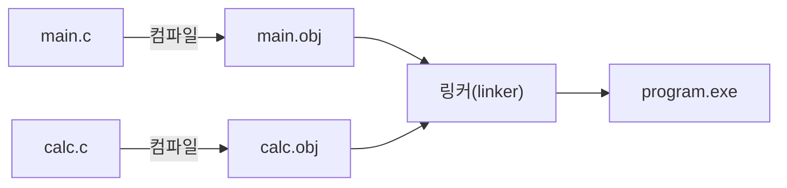

처음에는 모든 코드를 `main.c` 하나에 몰아넣어도 잘 돌아갑니다. 그러다 코드가 수백 줄로 늘어나면 함수 하나를 찾기도 어려워지고, 다른 프로젝트에서 재사용하기도, 여럿이 나눠 작업하기도 힘들어집니다. 이 글은 Visual Studio로 C를 배우는 사람을 대상으로, 파일을 어떻게 나누고 `extern`·`static`·include guard를 언제 쓰는지 순서대로 설명합니다.

## 1. 왜 파일을 나누나 — 번역 단위라는 개념

C의 컴파일은 `.c` 파일 단위로 이루어집니다. 컴파일러는 `.c` 파일 하나를 **번역 단위(translation unit)**라는 독립된 덩어리로 보고 각각 따로 `.obj`(오브젝트 파일)로 번역합니다. 그다음 **링커(linker)**가 이 오브젝트 파일들을 이어 붙여 최종 실행 파일을 만듭니다.



이 그림 하나가 뒤에 나오는 내용 대부분의 출발점입니다. 컴파일은 파일별로 따로 이루어지고, 서로 다른 파일의 코드를 연결하는 일은 맨 마지막에 링커가 한다는 것 — `extern`도, 링커 오류도 모두 여기서 비롯됩니다.

## 2. 선언과 정의를 구분한다

구조 분리의 대부분은 이 한 가지 원칙으로 설명됩니다. **선언(declaration)은 헤더 파일(.h)에 두고, 정의(definition)는 소스 파일(.c)에 둔다.**

| 구분 | 뜻 | 예시 |
|------|----|----|
| 선언 | "이런 게 있다"고 알리기 (실체 없음) | `int add(int a, int b);` |
| 정의 | 실제 내용·실체를 만들기 | `int add(int a, int b) { return a + b; }` |

헤더(.h)를 메뉴판, 소스(.c)를 주방에 비유할 수 있습니다. 메뉴판에는 무엇을 파는지만 적고, 실제 조리는 주방에서 합니다. 손님(다른 파일)은 메뉴판만 보고 주문하면 됩니다.

선언은 여러 번 해도 괜찮지만, 정의는 프로그램 전체에서 딱 한 번만 있어야 합니다. 이를 **단일 정의 규칙(One Definition Rule)**이라고 합니다. 이 규칙을 어기면 뒤에서 볼 중복 정의 링커 오류가 납니다.

## 3. 헤더 파일과 include guard

헤더에는 보통 함수 선언, 매크로, 구조체 정의, 타입 정의를 넣습니다. 이때 거의 항상 **include guard**가 필요합니다.

```c
// calc.h
#ifndef CALC_H     // CALC_H가 아직 정의되지 않았다면
#define CALC_H     // CALC_H를 정의하고 아래 내용을 포함한다

int add(int a, int b);
int sub(int a, int b);

#endif // CALC_H
```

헤더는 여러 파일에서 `#include` 됩니다. 만약 `a.h`가 `calc.h`를 포함하고, `main.c`가 `a.h`와 `calc.h`를 둘 다 포함하면, `calc.h`의 내용이 두 번 복사되어 중복 정의 오류가 납니다. include guard는 "이미 한 번 포함했으면 두 번째부터는 건너뛴다"는 장치로, 이런 중복 포함을 막습니다.

Visual Studio를 비롯한 대부분의 컴파일러는 더 짧은 방법도 지원합니다.

```c
// calc.h
#pragma once      // 이 파일은 한 번만 포함한다 (한 줄로 끝)

int add(int a, int b);
int sub(int a, int b);
```

`#pragma once`는 간결하지만 표준이 아닙니다(다만 주요 컴파일러는 사실상 모두 지원). 이식성을 최우선으로 한다면 `#ifndef` 방식을, 편의성을 원한다면 `#pragma once`를 쓰면 됩니다. 두 방식을 같이 쓸 필요는 없고, 하나면 충분합니다.

## 4. 함수 분리 — 기본 예제

덧셈·뺄셈을 별도 파일로 분리해 보겠습니다. 파일은 세 개입니다.

```c
// calc.h  ── 선언 (메뉴판)
#pragma once
int add(int a, int b);
int sub(int a, int b);
```

```c
// calc.c  ── 정의 (주방)
#include "calc.h"           // 자기 선언을 먼저 포함해 일치 여부를 검사

int add(int a, int b) {
    return a + b;
}
int sub(int a, int b) {
    return a - b;
}
```

```c
// main.c  ── 사용하는 쪽
#include <stdio.h>
#include "calc.h"           // calc.c가 아니라 calc.h를 포함한다

int main(void) {
    printf("3 + 2 = %d\n", add(3, 2));
    printf("3 - 2 = %d\n", sub(3, 2));
    return 0;
}
```

두 가지만 기억하면 됩니다. 첫째, `main.c`는 `calc.c`가 아니라 `calc.h`(메뉴판)만 포함합니다. 실제 코드는 링커가 `calc.obj`에서 찾아 연결해 줍니다. 둘째, 내 헤더는 `#include "calc.h"`처럼 큰따옴표로, 표준 헤더는 `#include <stdio.h>`처럼 꺾쇠로 씁니다. 큰따옴표는 내 프로젝트 폴더부터 찾으라는 뜻이고, 꺾쇠는 시스템 폴더에서 찾으라는 뜻입니다.

## 5. 여러 파일이 변수를 공유하기 — extern

함수뿐 아니라 전역 변수를 여러 파일이 함께 쓰고 싶을 때가 있습니다. 예를 들어 게임의 현재 점수를 여러 파일이 읽고 써야 한다고 해 봅시다. 이때 쓰는 것이 `extern`입니다.

규칙은 하나입니다. 전역 변수는 정확히 한 개의 `.c` 파일에서 정의하고, 그 변수를 쓰려는 다른 모든 파일에서는 `extern`으로 선언합니다.

```c
// game_state.h  ── extern "선언"만 둔다 (메모리를 만들지 않음)
#pragma once
extern int g_score;        // "g_score라는 int가 어딘가에 있다"고 알림
void add_score(int p);
```

```c
// game_state.c  ── 실제 "정의" (메모리를 여기서 딱 한 번 만든다)
#include "game_state.h"

int g_score = 0;           // 진짜 정의 (extern 없이, 여기 단 한 곳)

void add_score(int p) {
    g_score += p;
}
```

```c
// main.c
#include <stdio.h>
#include "game_state.h"    // extern 선언을 가져옴

int main(void) {
    add_score(10);
    add_score(5);
    printf("점수: %d\n", g_score);   // 15
    return 0;
}
```

`extern int g_score;`는 선언입니다. 메모리를 만들지 않고, "이 변수는 다른 파일에 있다"고 컴파일러에게 알릴 뿐입니다. 그래서 여러 파일(헤더)에 들어가도 안전합니다. 반면 `int g_score = 0;`은 정의로, 이 줄이 실제 메모리를 할당합니다. 그래서 단 하나의 `.c`에만 있어야 합니다.

한 가지 흔한 실수가 있습니다. `extern int g_score = 0;`처럼 `extern`을 붙인 채 값으로 초기화하면 컴파일러는 이를 정의로 취급합니다. 그러면 정의가 두 곳이 되어 중복 정의 오류가 납니다. `extern`에는 초깃값을 주지 않습니다.

## 6. 파일 안에서만 쓰기 — static

`static`은 `extern`의 반대입니다. 전역 변수나 함수 앞에 `static`을 붙이면 그 변수·함수는 자신이 선언된 `.c` 파일 안에서만 보이고, 다른 파일에서는 접근할 수 없습니다. 이를 **내부 링크(internal linkage)**라고 합니다.

```c
// logger.c
static int s_log_count = 0;      // 이 파일 전용. 다른 파일은 못 본다.

static void write_line(const char* msg) {   // 이 파일 전용 도우미 함수
    s_log_count++;
    // ... 실제 출력 ...
}

void log_info(const char* msg) {  // static이 아니므로 외부에 공개
    write_line(msg);
}
```

다른 파일에 보여 줄 필요가 없는 내부 전용 변수·함수에 `static`을 붙이면, 이름 충돌을 막고 "이건 내부 구현일 뿐"이라는 의도를 코드로 드러낼 수 있습니다. 밖에 공유할 전역은 `extern`과 한 곳의 정의로, 파일 안에서만 쓸 전역은 `static`으로 — 이렇게 기억하면 됩니다.

참고로 함수 안에서 쓰는 `static` 지역 변수는 의미가 조금 다릅니다. 이때 `static`은 함수가 끝나도 값이 사라지지 않고 유지된다는 뜻입니다(예: 호출 횟수 세기). 같은 키워드지만 전역에 붙을 때는 링크 범위를 제한하고, 지역에 붙을 때는 수명을 연장한다는 점만 구분해 두면 됩니다.

## 7. 자주 만나는 링커·컴파일 오류

구조를 나누기 시작하면 아래 오류를 거의 반드시 만납니다. 미리 알아 두면 당황하지 않습니다.

| 오류 코드 | 뜻 | 원인과 해결 |
|-----------|----|-----------|
| C1083 | `cannot open include file` | 헤더 경로가 틀림. `#include` 파일명·경로와 큰따옴표/꺾쇠 구분 확인 |
| LNK2019 | `unresolved external symbol` | 선언만 있고 정의가 없음. 함수 몸통을 안 만들었거나 해당 `.c`가 프로젝트에 빠짐 |
| LNK2005 | `already defined` (중복 정의) | 정의가 두 번 있음. 헤더에 함수 몸통·변수 정의를 넣었거나, `extern`에 초깃값을 줬거나, 가드를 빠뜨림 |

가장 헷갈리는 둘은 LNK2019와 LNK2005입니다. 정의가 모자라면 LNK2019(해당 `.c`를 프로젝트에 추가했는지 확인), 정의가 넘치면 LNK2005(헤더에 실제 코드를 넣지 않았는지, include guard가 있는지 확인)로 기억하면 구분하기 쉽습니다.

## 8. Visual Studio에서 직접 해보기

1. 솔루션 탐색기에서 프로젝트 이름을 마우스 오른쪽 클릭 → 추가 → 새 항목.
2. 헤더 파일(.h)을 골라 `calc.h`를 만들고, C++ 파일(.cpp)을 골라 이름을 `calc.c`로 바꿔 만듭니다. 확장자를 `.cpp`로 두면 C++로 컴파일되므로, 순수 C로 작성하려면 반드시 `.c`로 저장합니다.
3. `.c` 파일을 추가하면 Visual Studio가 자동으로 프로젝트에 포함해 함께 컴파일합니다. 이 과정이 빠지면 LNK2019가 납니다.
4. `Ctrl + F7`로 파일 하나만 컴파일해 보고, `F7`(빌드)로 전체를 연결해 봅니다.

## 9. 체크리스트

- 하나의 파일은 하나의 역할만 맡는다 (계산은 `calc.c`, 로그는 `logger.c`).
- 선언은 `.h`에, 정의는 `.c`에 둔다.
- 모든 헤더에 include guard(`#pragma once` 또는 `#ifndef`)를 넣는다.
- 헤더에는 함수 몸통이나 변수 정의를 넣지 않는다 (선언만).
- 공유 전역 변수는 헤더에 `extern` 선언, 한 `.c`에 정의한다.
- 파일 내부 전용 변수·함수에는 `static`을 붙인다.
- `.c`는 자신의 짝 헤더를 가장 먼저 `#include` 한다 (선언과 정의의 불일치를 일찍 발견).

처음에는 번거로워 보여도, 이 습관이 몸에 배면 코드가 수천 줄로 늘어나도 길을 잃지 않습니다. 작은 예제부터 직접 파일을 나눠 보며 익히는 것이 가장 빠릅니다.

## 참고 자료
- [Microsoft Learn — extern을 사용하여 링크 지정](https://learn.microsoft.com/ko-kr/previous-versions/0603949d(v=vs.120))
- [cppreference — Storage class specifiers](https://en.cppreference.com/w/c/language/storage_duration)
