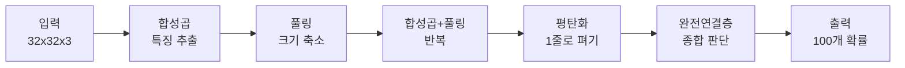
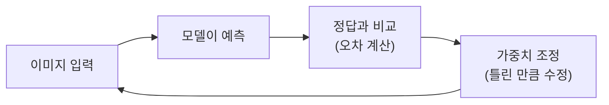

> **대상 독자**: CNN(합성곱 신경망)을 처음 접하는 분. 코드가 **개념적으로 어떻게 흘러가는지**를 그림으로 이해하는 데 초점을 둡니다.
>
> 간단한 모델로 시작해, **왜 그렇게 동작하는지** 이해한 뒤, **정확도를 올리는 실전 기법**까지 나아갑니다.

## 1. CIFAR-100 데이터셋이란?

CIFAR-100은 **32×32 픽셀 컬러 사진 6만 장**으로 이루어진 데이터셋입니다.

- 사진마다 **100개 분류(클래스)** 중 하나의 정답이 붙어 있습니다. (사과, 자전거, 고래 등)
- 학습용 5만 장, 테스트용 1만 장으로 나뉩니다. **클래스당 학습 이미지가 500장**뿐이라, 모델이 일반화하기 쉽지 않은 **다소 어려운** 데이터셋입니다.

목표는 **"사진을 넣으면 100개 중 어떤 종류인지 맞히는 모델"**을 만드는 것입니다.

## 2. CNN이 이미지를 처리하는 큰 흐름

CNN은 이미지를 한 번에 이해하지 않고, **단계적으로 특징을 뽑아내며** 판단합니다.



직관으로 요약하면,

- **합성곱(Convolution)**: 작은 **필터(돋보기)**로 이미지를 훑으며 "선·모서리·색 덩어리" 같은 특징을 찾습니다. 층이 깊어질수록 더 복잡한 특징(눈, 바퀴)을 잡습니다.
- **풀링(Pooling)**: 이미지를 **요약해 작게** 만듭니다. 계산량을 줄이고 핵심만 남깁니다.
- **완전연결층(Dense)**: 지금까지 뽑은 특징을 **종합해 최종 판단**을 내립니다.
- **출력**: 100개 클래스의 확률을 내보냅니다. 가장 높은 값이 모델의 답입니다.

### 합성곱의 3대 개념: 필터·스트라이드·패딩

- **필터(커널)**: 보통 3×3 크기의 작은 격자. 이미지를 훑으며 특정 패턴에 반응합니다. 필터 개수가 많을수록 더 다양한 특징을 잡습니다.
- **스트라이드(stride)**: 필터가 **몇 칸씩 건너뛰며** 이동할지. 1이면 촘촘히, 2면 절반 크기로 줄어듭니다.
- **패딩(padding)**: 이미지 가장자리에 0을 둘러 **크기를 유지**(`same`)하거나, 두르지 않아 **조금 줄어들게**(`valid`) 합니다.

## 3. 기본 CNN 코드 (먼저 가장 단순하게)

```python
import tensorflow as tf
from tensorflow.keras import layers, models

# (1) 데이터 불러오기
(x_train, y_train), (x_test, y_test) = tf.keras.datasets.cifar100.load_data()

# (2) 전처리: 픽셀 값(0~255)을 0~1로 정규화
x_train = x_train.astype("float32") / 255.0
x_test  = x_test.astype("float32") / 255.0

# (3) 모델 정의
model = models.Sequential([
    layers.Input(shape=(32, 32, 3)),
    layers.Conv2D(32, (3, 3), activation="relu"),   # 합성곱 1
    layers.MaxPooling2D((2, 2)),                     # 풀링 1
    layers.Conv2D(64, (3, 3), activation="relu"),   # 합성곱 2
    layers.MaxPooling2D((2, 2)),                     # 풀링 2
    layers.Flatten(),                                # 1줄로 펴기
    layers.Dense(128, activation="relu"),            # 완전연결층
    layers.Dense(100, activation="softmax"),         # 출력: 100개 확률
])

# (4) 학습 방법 설정
model.compile(optimizer="adam",
              loss="sparse_categorical_crossentropy",
              metrics=["accuracy"])

# (5) 학습
model.fit(x_train, y_train, epochs=10, validation_data=(x_test, y_test))
```

### 코드 각 부분의 의미

- **전처리(정규화)**: 픽셀 값을 255로 나눠 0~1로 맞추면 학습이 더 안정적이고 빠릅니다.
- **`activation="relu"`**: "음수는 0으로" 바꾸는 간단한 규칙. 신경망이 복잡한 패턴을 배우게 돕습니다.
- **`softmax`**: 출력을 **합이 1인 확률**로 바꿉니다.
- **`optimizer="adam"`**: 틀린 만큼 가중치를 조정하는 "학습 담당자".
- **`loss`**: 모델의 답이 정답과 얼마나 다른지 재는 자. 이 값을 줄이는 방향으로 학습합니다.
- **`epochs=10`**: 전체 데이터를 10번 반복 학습.

## 4. 학습이 똑똑해지는 원리



모델은 **"예측 → 채점 → 수정"**을 수없이 반복합니다(이 수정 과정을 **역전파**라고 합니다). 처음엔 아무렇게나 찍던 모델이 점점 정답을 잘 맞히게 됩니다.

## 5. 정확도를 끌어올리는 실전 기법

위의 단순 모델은 CIFAR-100에서 정확도가 낮습니다(클래스가 100개로 많기 때문). 성능을 올리는 **검증된 3가지 기법**을 소개합니다.

### (1) 배치 정규화(Batch Normalization)
각 층을 지난 값의 분포를 **고르게 맞춰** 학습을 빠르고 안정적으로 만듭니다. 보통 **합성곱 바로 뒤, 활성화 함수 앞**에 넣습니다.

### (2) 드롭아웃(Dropout)
학습할 때 뉴런 일부를 **임의로 꺼서**, 모델이 특정 뉴런에만 의존하지 않게 합니다. **과적합(훈련 데이터만 외우는 현상)**을 줄입니다. 보통 0.2~0.5 사이 값을 씁니다.

### (3) 데이터 증강(Data Augmentation)
학습 이미지를 **살짝 변형**(이동·좌우반전 등)해 데이터를 다양하게 만듭니다. CIFAR-100처럼 **클래스당 이미지가 적을 때 특히 효과적**입니다. 표준 기법은 **"가장자리를 4픽셀 덧대고 랜덤하게 32×32로 자른 뒤, 좌우 반전"**입니다.

### 개선된 모델 예시

```python
from tensorflow.keras import layers, models

def conv_block(x, filters):
    x = layers.Conv2D(filters, 3, padding="same")(x)
    x = layers.BatchNormalization()(x)     # (1) 배치 정규화
    x = layers.Activation("relu")(x)
    x = layers.Conv2D(filters, 3, padding="same")(x)
    x = layers.BatchNormalization()(x)
    x = layers.Activation("relu")(x)
    x = layers.MaxPooling2D()(x)
    return x

inputs = layers.Input((32, 32, 3))
# (3) 데이터 증강 — 학습 때만 자동 적용됨
x = layers.RandomFlip("horizontal")(inputs)
x = layers.RandomTranslation(0.1, 0.1)(x)
x = conv_block(x, 64)
x = conv_block(x, 128)
x = conv_block(x, 256)
x = layers.GlobalAveragePooling2D()(x)
x = layers.Dropout(0.4)(x)                 # (2) 드롭아웃
outputs = layers.Dense(100, activation="softmax")(x)

model = models.Model(inputs, outputs)
model.compile(optimizer="adam",
              loss="sparse_categorical_crossentropy",
              metrics=["accuracy"])
```

> **과적합 신호 읽는 법**: 학습을 돌릴 때 `accuracy`(훈련 정확도)는 계속 오르는데 `val_accuracy`(검증 정확도)가 더는 안 오르거나 떨어지면, 모델이 **훈련 데이터만 외우는 중**입니다. 이때 드롭아웃·데이터 증강이 해결사 역할을 합니다.

## 6. 정리

- CNN의 큰 흐름은 **"특징 추출(합성곱·풀링) → 종합 판단(완전연결) → 확률 출력(softmax)"**입니다.
- 학습은 **"예측 → 채점 → 수정"의 반복**입니다.
- 정확도를 올리려면 **배치 정규화 + 드롭아웃 + 데이터 증강**을 조합하고, **검증 정확도**로 과적합을 감시하세요.

이 흐름만 잡으면 더 복잡한 모델(ResNet 등)도 결국 같은 원리의 확장임을 알 수 있습니다.

## 참고 자료
- [Keras CNN for CIFAR-100 (Andrew Kruger)](https://andrewkruger.github.io/projects/2017-08-05-keras-convolutional-neural-network-for-cifar-100)
- [CNN-CIFAR-100 예제 저장소 (GitHub)](https://github.com/LeoTungAnh/CNN-CIFAR-100)
- [A more ambitious dataset: CIFAR-100 (Jeremy Fix)](https://jeremyfix.github.io/deeplearning-lectures/keras/cifar)
