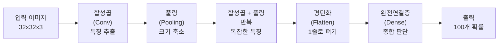
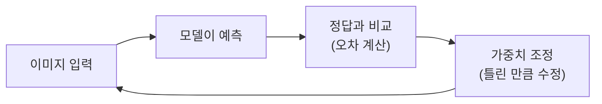

# CIFAR-100으로 배우는 TensorFlow CNN: 구조와 흐름을 눈으로 이해하기

> 대상: CNN(합성곱 신경망)을 처음 접하는 분. 코드가 "개념적으로 어떻게 흘러가는지" 그림으로 이해하는 데 초점을 둡니다.

## 1. CIFAR-100 데이터셋이란?

CIFAR-100은 **32×32 픽셀 크기의 작은 컬러 사진 6만 장**으로 이루어진 데이터셋입니다.

- 사진마다 **100개의 분류(클래스)** 중 하나의 정답이 붙어 있습니다. (예: 사과, 자전거, 고래 등)
- 학습용 5만 장, 테스트용 1만 장으로 나뉩니다.

우리의 목표는 **"사진을 입력하면 100개 중 어떤 종류인지 맞히는 모델"**을 만드는 것입니다.

## 2. CNN이 이미지를 처리하는 큰 흐름

CNN은 이미지를 한 번에 이해하지 않고, **단계적으로 특징을 뽑아내며** 판단합니다. 전체 흐름은 다음과 같습니다.



핵심 직관은 이렇습니다.

- **합성곱(Convolution):** 작은 돋보기로 이미지를 훑으며 **"선, 모서리, 색 덩어리" 같은 특징**을 찾습니다. 층이 깊어질수록 더 복잡한 특징(눈, 바퀴 등)을 잡습니다.
- **풀링(Pooling):** 이미지를 **요약해서 작게** 만듭니다. 계산량을 줄이고 핵심만 남깁니다.
- **완전연결층(Dense):** 지금까지 뽑은 특징을 **종합해서 최종 판단**을 내립니다.
- **출력:** 100개 클래스에 대한 확률을 내보냅니다. 가장 높은 값이 모델의 답입니다.

## 3. 간단한 TensorFlow CNN 코드

아래는 최대한 단순하게 작성한 전체 코드입니다. 주석을 따라가며 읽어 보세요.

```python
import tensorflow as tf
from tensorflow.keras import layers, models

# (1) 데이터 불러오기
(x_train, y_train), (x_test, y_test) = tf.keras.datasets.cifar100.load_data()

# (2) 전처리: 픽셀 값을 0~1 사이로 정규화
x_train = x_train.astype("float32") / 255.0
x_test  = x_test.astype("float32") / 255.0

# (3) 모델 구조 정의
model = models.Sequential([
    layers.Input(shape=(32, 32, 3)),          # 입력: 32x32 컬러 이미지

    layers.Conv2D(32, (3, 3), activation="relu"),  # 합성곱 1 (특징 추출)
    layers.MaxPooling2D((2, 2)),                    # 풀링 1 (크기 절반)

    layers.Conv2D(64, (3, 3), activation="relu"),  # 합성곱 2 (더 복잡한 특징)
    layers.MaxPooling2D((2, 2)),                    # 풀링 2

    layers.Flatten(),                               # 2차원 특징을 1줄로 펴기
    layers.Dense(128, activation="relu"),           # 완전연결층 (종합)
    layers.Dense(100, activation="softmax"),        # 출력: 100개 클래스 확률
])

# (4) 학습 방법 설정
model.compile(
    optimizer="adam",                               # 가중치를 조정하는 방법
    loss="sparse_categorical_crossentropy",         # 정답과의 오차 측정 방법
    metrics=["accuracy"],                           # 정확도를 함께 확인
)

# (5) 학습 실행
model.fit(x_train, y_train, epochs=10, validation_data=(x_test, y_test))
```

## 4. 코드의 흐름을 단계별로 설명

### (1) 데이터 불러오기
`cifar100.load_data()` 한 줄로 학습용·테스트용 데이터가 나뉘어 들어옵니다.

### (2) 전처리 (정규화)
픽셀 값은 원래 0~255입니다. 이를 **255로 나눠 0~1 사이로** 바꿉니다. 값의 범위를 작게 맞춰 주면 학습이 **더 안정적이고 빠르게** 진행됩니다.

### (3) 모델 구조 — "특징 추출 → 판단" 순서
- `Conv2D` + `MaxPooling2D` 묶음이 **특징을 뽑는 부분**입니다. 이 묶음을 반복할수록 더 깊은 특징을 잡습니다.
- `Flatten`은 2차원 특징 지도를 **일렬로 펴서** 다음 층에 넘깁니다.
- `Dense(128)`은 특징을 **종합**하고, `Dense(100)`은 **100개 클래스의 확률**을 출력합니다.
- `activation="relu"`는 "음수는 0으로 바꾸는" 간단한 규칙으로, 신경망이 **복잡한 패턴**을 배우게 돕습니다.
- 마지막 `activation="softmax"`는 출력을 **합이 1인 확률**로 바꿔 줍니다.

### (4) 학습 방법 설정 (compile)
- **optimizer(adam):** 틀린 만큼 가중치를 조금씩 고치는 **"학습 담당자"**입니다.
- **loss:** 모델의 답이 정답과 **얼마나 다른지** 재는 자입니다. 이 값을 줄이는 방향으로 학습합니다.
- **metrics(accuracy):** 사람이 보기 쉬운 **정확도**를 함께 표시합니다.

### (5) 학습 실행 (fit)
`epochs=10`은 전체 데이터를 **10번 반복 학습**한다는 뜻입니다. 학습이 진행되면 loss는 줄고 accuracy는 오르는 것이 정상입니다.

## 5. 학습이 반복되며 똑똑해지는 원리



모델은 **"예측 → 채점 → 수정"**을 수없이 반복합니다. 이 과정을 거치며 처음에는 아무렇게나 찍던 모델이 점점 정답을 잘 맞히게 됩니다.

## 6. 참고: 더 좋은 성능을 내려면

CIFAR-100은 클래스가 100개로 많아, 위의 단순한 모델로는 정확도가 높지 않습니다. 성능을 올리려면 다음을 시도해 보세요.

- 합성곱 층을 **더 깊게** 쌓기
- **배치 정규화(BatchNormalization)**와 **드롭아웃(Dropout)** 추가하기
- **데이터 증강(회전·반전 등)**으로 데이터를 다양하게 만들기

하지만 지금 단계에서 중요한 것은 **"특징 추출 → 종합 판단 → 확률 출력"**이라는 CNN의 큰 흐름을 이해하는 것입니다. 이 흐름만 잡으면 더 복잡한 모델도 어렵지 않습니다.
