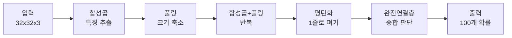
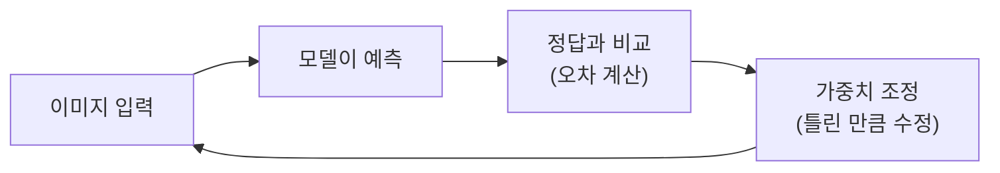

CNN을 처음 공부할 때 가장 막히는 지점은 "코드는 돌아가는데 그 안에서 데이터가 무슨 일을 겪는지 모르겠다"는 것입니다. 이 글은 CIFAR-100 분류기를 만들면서, 이미지 한 장이 입력에서 출력까지 가는 동안 **텐서의 모양이 어떻게 변하는지**를 층마다 따라갑니다. 그리고 그 과정에 등장하는 Conv2D, MaxPooling, ReLU, softmax가 각각 무엇이고 왜 필요한지 하나씩 짚습니다.

## 1. CIFAR-100 데이터셋

CIFAR-100은 32×32 픽셀 컬러 사진 6만 장으로 이루어진 데이터셋입니다. 사진마다 100개 분류(사과, 자전거, 고래 등) 중 하나가 정답으로 붙어 있고, 학습용 5만 장과 테스트용 1만 장으로 나뉩니다. 클래스당 학습 이미지가 500장뿐이라, 모델이 일반화하기에 꽤 까다로운 편입니다.

컬러 사진 한 장은 숫자로는 **32×32×3** 모양의 텐서입니다. 가로 32, 세로 32 픽셀이고, 마지막 3은 각 픽셀의 빨강·초록·파랑(RGB) 값입니다. 목표는 이 텐서를 넣으면 100개 중 어떤 분류인지 맞히는 모델을 만드는 것입니다.

## 2. 큰 흐름: 특징을 뽑고, 요약하고, 판단한다

CNN은 이미지를 한 번에 이해하지 않습니다. 작은 특징부터 찾아 점점 추상적인 특징으로 쌓아 올린 다음, 마지막에 종합해서 판단합니다.



앞부분(합성곱·풀링)은 "이미지에서 무엇이 보이는가"를 찾는 단계이고, 뒷부분(완전연결·출력)은 "그래서 이게 무엇인가"를 결정하는 단계입니다. 이제 각 층이 실제로 무엇을 하는지 봅니다.

## 3. Conv2D — 작은 필터로 특징을 찾는 층

**합성곱층(Conv2D)**은 작은 격자 모양의 **필터(커널)**를 이미지 위에서 한 칸씩 미끄러뜨리며, 필터와 겹친 영역의 값을 곱해 더합니다. 그 결과로 "이 위치에 이 패턴이 얼마나 있는가"를 나타내는 숫자가 나오고, 이미지를 다 훑으면 **특징 맵(feature map)** 한 장이 만들어집니다.

핵심 개념 세 가지만 잡으면 됩니다.

- **필터(커널)**: 보통 3×3 크기의 작은 격자. 선·모서리·색 덩어리 같은 특정 패턴에 반응합니다. 필터 개수를 늘리면 그만큼 다양한 특징을 동시에 찾습니다. `Conv2D(32, (3,3))`은 3×3 필터 32개를 쓴다는 뜻이고, 결과로 특징 맵 32장이 나옵니다.
- **스트라이드(stride)**: 필터가 몇 칸씩 건너뛰며 움직일지. 1이면 촘촘히 훑고, 2면 결과 크기가 절반으로 줄어듭니다.
- **패딩(padding)**: 가장자리에 0을 둘러 크기를 유지할지(`same`) 두르지 않을지(`valid`)를 정합니다. `valid`면 필터가 테두리를 벗어나지 못해 결과가 약간 작아집니다.

Conv2D가 Dense(완전연결)보다 이미지에 적합한 이유는 두 가지입니다. 첫째, 같은 필터를 이미지 전체에 재사용하므로(**가중치 공유**) 학습할 값이 훨씬 적습니다. 둘째, 그 덕분에 "고양이 귀"가 사진 어느 위치에 있든 같은 필터로 잡아낼 수 있습니다.

3×3 필터를 `valid`로 32×32 이미지에 적용하면 출력 크기는 `32 - 3 + 1 = 30`이 됩니다. 즉 32×32×3이 Conv2D(32)를 지나면 **30×30×32**가 됩니다.

## 4. MaxPooling2D — 핵심만 남기고 크기를 줄이는 층

**풀링층(MaxPooling2D)**은 특징 맵을 일정 구역(보통 2×2)으로 나누고, 각 구역에서 **가장 큰 값 하나만** 남깁니다. 2×2 풀링은 가로·세로를 각각 절반으로 줄입니다.

풀링을 쓰는 이유는 세 가지입니다. 계산량과 메모리를 줄이고, 특징이 조금 움직여도 결과가 크게 흔들리지 않게 하며(작은 위치 변화에 둔감해짐), "가장 강하게 반응한 특징"만 남겨 중요한 정보를 추립니다. 풀링은 학습할 값이 없는 고정 연산이라 모델을 무겁게 하지 않습니다.

30×30×32에 2×2 풀링을 적용하면 가로·세로가 절반이 되어 **15×15×32**가 됩니다. 채널 수(32)는 그대로입니다. 풀링은 크기만 줄이고 특징 맵의 장수는 건드리지 않기 때문입니다.

## 5. ReLU — 비선형성을 넣는 활성화 함수

합성곱이나 완전연결은 본질적으로 곱하고 더하는 **선형 연산**입니다. 선형 연산만 여러 층 쌓으면, 아무리 깊어도 결국 하나의 선형식으로 합쳐져 복잡한 패턴을 배우지 못합니다. 그래서 층 사이에 곡선을 만들어 주는 **활성화 함수**가 필요하고, 오늘날 기본으로 쓰이는 것이 **ReLU**입니다.

ReLU의 규칙은 아주 단순합니다.

```text
ReLU(x) = max(0, x)   # 음수는 0으로, 양수는 그대로
```

ReLU가 표준이 된 배경이 있습니다. 예전에는 sigmoid나 tanh를 주로 썼는데, 이 함수들은 입력이 조금만 커지거나 작아져도 출력이 0 또는 1 근처에서 평평해집니다. 그러면 그 지점의 기울기가 거의 0이 되어, 층을 거슬러 올라가며 학습 신호를 전달하는 과정에서 신호가 점점 사라집니다(**기울기 소실**). 깊은 신경망이 학습되지 않던 주된 이유였습니다.

ReLU는 양수 구간에서 기울기가 항상 1이라 신호가 약해지지 않고, 계산도 "음수면 0" 하나로 끝나 매우 빠릅니다. 2012년 AlexNet이 ReLU로 깊은 망을 성공적으로 학습시킨 뒤로 사실상 기본값이 되었습니다. 다만 음수 입력에서는 출력과 기울기가 모두 0이라, 일부 뉴런이 계속 0만 내보내며 죽는 경우가 있습니다(**dying ReLU**). 이를 완화하려고 음수에도 작은 기울기를 주는 Leaky ReLU 같은 변형도 쓰입니다.

ReLU는 값의 크기만 바꿀 뿐 텐서의 모양은 바꾸지 않습니다. 15×15×32는 ReLU를 지나도 그대로 15×15×32입니다.

## 6. Flatten과 Dense — 특징을 펴서 종합 판단

합성곱과 풀링을 몇 번 반복해 특징 맵이 충분히 작아지면, 이를 1차원으로 펴서(**Flatten**) 일반 신경망에 넣습니다. 예를 들어 6×6×64 특징 맵을 펴면 `6 × 6 × 64 = 2304`개의 숫자가 한 줄로 늘어섭니다.

이 줄을 받는 것이 **완전연결층(Dense)**입니다. 모든 입력을 모든 출력에 연결해, 지금까지 뽑은 특징을 종합해서 최종 판단에 쓸 형태로 섞습니다. `Dense(128)`은 2304개 입력을 128개 값으로 요약하고, 마지막 `Dense(100)`은 그것을 100개 클래스에 대한 점수로 바꿉니다.

## 7. softmax — 점수를 확률로 바꾸는 출력

마지막 Dense가 내놓는 100개 숫자는 아직 크기만 다른 **점수(로짓)**일 뿐, 확률이 아닙니다. 여기에 **softmax**를 씌우면 이 점수들이 "합이 1이고 모두 0 이상인" 확률 분포로 바뀝니다.

softmax는 각 점수에 지수함수를 취한 뒤 전체 합으로 나눕니다. 그래서 점수가 큰 클래스일수록 확률이 커지되, 모든 확률의 합은 1이 됩니다. 분류 문제에서 "이 사진이 고래일 확률 0.7, 상어일 확률 0.2 …"처럼 해석 가능한 출력을 얻으려고 마지막 층에 둡니다. 모델의 최종 답은 이 확률이 가장 높은 클래스입니다.

## 8. 기본 CNN 코드

여기까지의 층을 그대로 쌓은 가장 단순한 모델입니다.

```python
import tensorflow as tf
from tensorflow.keras import layers, models

# (1) 데이터 불러오기
(x_train, y_train), (x_test, y_test) = tf.keras.datasets.cifar100.load_data()

# (2) 전처리: 픽셀 값(0~255)을 0~1로 정규화
x_train = x_train.astype("float32") / 255.0
x_test  = x_test.astype("float32") / 255.0

# (3) 모델 정의
model = models.Sequential([
    layers.Input(shape=(32, 32, 3)),
    layers.Conv2D(32, (3, 3), activation="relu"),   # 합성곱 1
    layers.MaxPooling2D((2, 2)),                     # 풀링 1
    layers.Conv2D(64, (3, 3), activation="relu"),   # 합성곱 2
    layers.MaxPooling2D((2, 2)),                     # 풀링 2
    layers.Flatten(),                                # 1줄로 펴기
    layers.Dense(128, activation="relu"),            # 완전연결층
    layers.Dense(100, activation="softmax"),         # 출력: 100개 확률
])

# (4) 학습 방법 설정
model.compile(optimizer="adam",
              loss="sparse_categorical_crossentropy",
              metrics=["accuracy"])

# (5) 학습
model.fit(x_train, y_train, epochs=10, validation_data=(x_test, y_test))
```

전처리에서 픽셀을 255로 나눠 0~1로 맞추는 것은 값의 범위를 작게 해 학습을 안정시키기 위함입니다. `optimizer="adam"`은 틀린 정도에 따라 가중치를 조정하는 방식이고, `loss`는 모델의 답이 정답과 얼마나 다른지를 재는 기준입니다. 학습은 이 loss를 줄이는 방향으로 진행되고, `epochs=10`은 전체 데이터를 열 번 반복한다는 뜻입니다.

## 9. 데이터의 모양이 층마다 어떻게 변하나

위 모델에서 이미지 한 장(32×32×3)이 각 층을 지나며 겪는 변화를 정리하면 다음과 같습니다. 크기 계산은 Conv2D(`valid`)가 `입력 − 커널 + 1`, 풀링이 `절반(내림)`입니다.

| 층 | 연산 | 출력 모양 | 설명 |
|----|------|-----------|------|
| 입력 | — | 32 × 32 × 3 | RGB 원본 이미지 |
| Conv2D(32, 3×3) | 32 − 3 + 1 | 30 × 30 × 32 | 필터 32개 → 특징 맵 32장 |
| MaxPooling(2×2) | 절반 | 15 × 15 × 32 | 가로·세로만 축소 |
| Conv2D(64, 3×3) | 15 − 3 + 1 | 13 × 13 × 64 | 필터 64개 → 특징 맵 64장 |
| MaxPooling(2×2) | 절반(내림) | 6 × 6 × 64 | 13 → 6 |
| Flatten | 6·6·64 | 2304 | 1줄로 펴기 |
| Dense(128) | — | 128 | 특징 종합 |
| Dense(100, softmax) | — | 100 | 클래스별 확률 |

표를 세로로 읽으면 흐름이 분명합니다. 앞으로 갈수록 **가로·세로는 줄고(32→6) 채널(특징 맵 수)은 늘어납니다(3→64).** 처음에는 넓고 얕은 "픽셀"이었다가, 점점 좁고 깊은 "추상적 특징"으로 바뀌는 것입니다. 마지막에 이를 펴서 100개 확률로 압축하면 분류가 끝납니다.

## 10. 학습이 똑똑해지는 원리



모델은 예측하고, 정답과 비교해 오차를 재고, 그 오차를 줄이는 쪽으로 가중치를 조금씩 고치는 과정을 수없이 반복합니다. 이 수정 과정을 **역전파**라고 합니다. 처음엔 거의 찍다시피 하던 모델이 반복을 거치며 점점 정답을 잘 맞히게 됩니다.

## 11. 정확도를 끌어올리는 기법

위 단순 모델은 클래스가 100개나 되는 CIFAR-100에서 정확도가 낮게 나옵니다. 널리 쓰이는 세 가지 보완책이 있습니다.

**배치 정규화(Batch Normalization)**는 각 층을 지난 값의 분포를 고르게 맞춰 학습을 빠르고 안정적으로 만듭니다. 보통 합성곱 바로 뒤, 활성화 함수 앞에 넣습니다.

**드롭아웃(Dropout)**은 학습할 때 뉴런 일부를 임의로 꺼서, 모델이 특정 뉴런에만 의존하지 못하게 합니다. 훈련 데이터만 통째로 외우는 과적합을 줄이는 효과가 있고, 보통 0.2~0.5 사이 값을 씁니다.

**데이터 증강(Data Augmentation)**은 학습 이미지를 살짝 변형(이동·좌우 반전 등)해 데이터를 다양하게 만듭니다. CIFAR-100처럼 클래스당 이미지가 적을 때 특히 효과가 큽니다.

이 세 가지를 반영한 모델은 다음과 같습니다.

```python
from tensorflow.keras import layers, models

def conv_block(x, filters):
    x = layers.Conv2D(filters, 3, padding="same")(x)
    x = layers.BatchNormalization()(x)     # 배치 정규화
    x = layers.Activation("relu")(x)
    x = layers.Conv2D(filters, 3, padding="same")(x)
    x = layers.BatchNormalization()(x)
    x = layers.Activation("relu")(x)
    x = layers.MaxPooling2D()(x)
    return x

inputs = layers.Input((32, 32, 3))
x = layers.RandomFlip("horizontal")(inputs)   # 데이터 증강 (학습 때만 적용)
x = layers.RandomTranslation(0.1, 0.1)(x)
x = conv_block(x, 64)
x = conv_block(x, 128)
x = conv_block(x, 256)
x = layers.GlobalAveragePooling2D()(x)
x = layers.Dropout(0.4)(x)                 # 드롭아웃
outputs = layers.Dense(100, activation="softmax")(x)

model = models.Model(inputs, outputs)
model.compile(optimizer="adam",
              loss="sparse_categorical_crossentropy",
              metrics=["accuracy"])
```

여기서 `padding="same"`을 쓴 이유는, 블록 안에서 합성곱이 크기를 줄이지 않게 해 풀링으로만 크기를 조절하기 위함입니다. 마지막의 `GlobalAveragePooling2D`는 Flatten 대신 각 특징 맵을 평균 한 값으로 요약해, 완전연결층의 덩치와 과적합을 함께 줄입니다.

과적합은 학습 중에 바로 알 수 있습니다. 훈련 정확도(`accuracy`)는 계속 오르는데 검증 정확도(`val_accuracy`)가 더는 오르지 않거나 떨어지기 시작하면, 모델이 훈련 데이터를 외우기 시작했다는 신호입니다. 이때 드롭아웃과 데이터 증강이 효과를 냅니다.

## 12. 요약

- 이미지는 CNN을 지나며 **가로·세로가 줄고 채널이 늘어나는** 방향으로 변합니다. 넓고 얕은 픽셀에서 좁고 깊은 특징으로 바뀌는 과정입니다.
- Conv2D는 필터로 특징을 찾고, MaxPooling은 핵심만 남겨 크기를 줄이며, ReLU는 비선형성을, softmax는 확률 출력을 담당합니다.
- 학습은 예측·채점·수정의 반복(역전파)이고, 정확도는 배치 정규화·드롭아웃·데이터 증강으로 끌어올립니다.

이 흐름을 잡아 두면 ResNet 같은 더 복잡한 모델도 결국 같은 원리의 확장이라는 것이 보입니다.

## 참고 자료
- [Keras CNN for CIFAR-100 (Andrew Kruger)](https://andrewkruger.github.io/projects/2017-08-05-keras-convolutional-neural-network-for-cifar-100)
- [CNN-CIFAR-100 예제 저장소 (GitHub)](https://github.com/LeoTungAnh/CNN-CIFAR-100)
- [CS231n — Convolutional Neural Networks](https://cs231n.github.io/convolutional-networks/)
