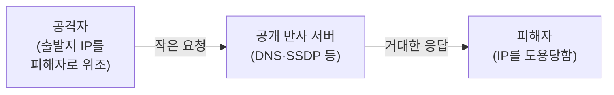
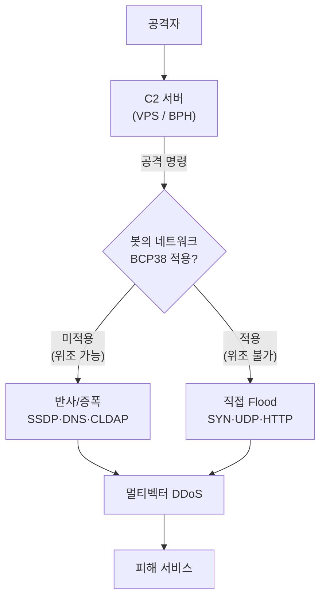

이 글은 예전에 작성했던 DDoS 레포트를 CISA, Cloudflare 같은 공신력 있는 자료로 다시 검증해 바로잡은 보완판입니다. 어떤 수치를 왜 고쳤는지는 글 끝의 "수정 내역"에 따로 정리해 두었습니다.

## 1. 증폭(반사) 공격이란

증폭(amplification) 공격은 공격자가 출발지 IP를 피해자의 IP로 위조한 작은 요청을 공개 서버(반사 서버)에 보내, 그 서버가 훨씬 큰 응답을 피해자에게 보내도록 만드는 방식입니다. 작은 요청으로 거대한 트래픽을 만들 수 있어 공격자가 선호합니다.

용어를 구분하면, **반사(reflection)**는 응답이 제3의 서버를 거쳐 피해자에게 향하게 하는 것이고, **증폭(amplification)**은 요청보다 응답이 훨씬 커서 트래픽이 부풀려지는 것입니다. 이때 요청 대비 응답이 몇 배 커지는지를 나타내는 값이 증폭률입니다.

## 2. 프로토콜별 증폭률

예전 레포트의 증폭률 일부가 부정확해 미국 CISA 공개 수치로 보정했습니다. 특히 DNS는 기존에 "약 15~22배"로 적었으나, 공개 자료 기준으로는 약 28~54배가 맞습니다.

| 프로토콜 | 기본 포트 | 대상 | 증폭률(대략) |
|----------|-----------|------|--------------|
| DNS | UDP/53 | Open Resolver | 약 28~54배 (ANY 질의) |
| NTP | UDP/123 | 구형 NTP 서버 | 최대 약 556배 (monlist) |
| SSDP | UDP/1900 | UPnP 장비(IoT) | 약 30배 |
| CLDAP | UDP/389 | Active Directory | 약 56~70배 |
| SNMP | UDP/161 | Public 노출 장비 | 높음 |
| Memcached | UDP/11211 | 노출된 캐시 서버 | 최대 약 51,000배 |
| CoAP | UDP/5683 | IoT 센서 | 중간 |
| TFTP | UDP/69 | 네트워크 장비 | 중간 |

증폭률은 서버 설정에 따라 편차가 매우 큽니다. CMU의 측정 연구(AMPMap)는 하나의 대표값으로 위험을 추정하면 실제와 크게 어긋날 수 있다고 지적하므로, 위 수치는 대략의 기준으로만 보는 편이 맞습니다.

한 가지 덧붙이면, 증폭 공격은 대역폭만의 문제가 아닙니다. SSDP는 증폭률 자체는 낮지만 초당 패킷 수(PPS)가 매우 높아 방어 장비에 부담을 줍니다. 그래서 증폭 공격은 대역폭(Tbps)과 패킷 수(Bpps) 두 축으로 나눠서 봐야 합니다.

## 3. Mirai에서 Aisuru로 — 봇넷의 진화

Mirai는 2016년 소스코드가 공개된 뒤 수백 개 변종으로 퍼진 대표적 IoT 봇넷입니다. 2025~2026년 보고서 기준으로 116종 이상의 변종, 2만 1천 개 이상의 샘플로 분석됩니다.

최근에는 Mirai 계열을 발전시킨 Aisuru(TurboMirai 계열) 봇넷이 공격 규모 기록을 다시 썼습니다. 감염 장비는 주로 가정용 IoT 하드웨어이고, 한 캠페인에서는 안드로이드 TV가 주요 공격원이었습니다. Cloudflare는 Aisuru 봇넷 규모를 100만~400만 대로 추정합니다. 이 밖에 Avtech 카메라와 Huawei 공유기를 표적으로 하는 Murdoc_Botnet 같은 변종도 관찰됩니다.

## 4. 2025~2026년 역대 최대 기록

- **31.4 Tbps**: 2025년 12월 Cloudflare가 차단한 역대 최대급 공격. "크리스마스 전야" 캠페인의 일부로 Aisuru-Kimwolf 봇넷이 일으켰고, 초당 2억 요청(RPS)에 달했으나 지속 시간은 35초였습니다.
- **29.7 Tbps / 14.1 Bpps**: 그 직전인 2025년 3분기 기록(역시 Aisuru 계열).
- **추세**: Cloudflare는 2026년 2분기에만 1 Tbps를 넘는 네트워크 계층 공격 805건을 차단했다고 보고했습니다. 직전 분기 130건에서 크게 늘어난 수치입니다.

요약하면 공격 규모는 수십 Tbps 시대로 들어섰고, 수십 초 동안 몰아치는 짧고 강한 고대역 공격이 흔해지고 있습니다.

## 5. 주요 반사 프로토콜

- **SSDP(UDP/1900)**: UPnP가 켜진 IoT 장비를 이용. Mirai 계열이 가장 많이 쓰는 반사 방식 중 하나입니다.
- **CLDAP(UDP/389)**: Active Directory 대상. 증폭률이 56~70배로 높아 기업망 공격에 자주 쓰입니다.
- **DNS(UDP/53)**: Open Resolver를 이용. ANY·DNSSEC·대형 TXT로 응답을 키웁니다. DNSSEC가 켜진 서버일수록 증폭률이 큽니다.
- **CoAP(UDP/5683)**: IoT 센서·스마트홈 대상. 증폭률은 낮지만 노출 장비가 많아 빈도가 늘고 있습니다.
- **Memcached(UDP/11211)**: 노출 시 수만 배까지 증폭될 수 있습니다(최대 약 51,000배).

## 6. IP 위조와 BCP38

증폭 공격의 전제 조건은 출발지 IP 위조입니다. 이를 막는 표준이 BCP38(송·수신 트래픽 필터링)입니다. BCP38이 적용된 네트워크에서는 IP 위조가 불가능하므로 반사·증폭 공격을 원천 차단할 수 있습니다. 문제는 전 세계 일부 ISP가 아직 이를 적용하지 않는다는 점입니다.

| 인프라 | 위조 가능성 | 특징 |
|--------|-------------|------|
| BCP38 미적용 ISP | 매우 높음 | 반사 공격의 핵심 인프라 |
| 불릿프루프 호스팅(BPH) | 높음 | 악용 신고 대응이 느림 |
| 중소 IDC | 높음 | ACL·필터링 미흡 사례 |
| 퍼블릭 클라우드 | 매우 낮음 | 출발지 검증 적용 |
| 가정용 ISP | 매우 낮음 | 대부분 uRPF·BCP38 적용 |

## 7. 반사 공격과 직접 공격

| 구분 | 반사/증폭 | 직접 Flood |
|------|-----------|------------|
| IP 위조 | 필수 | 불필요 |
| BCP38 영향 | 차단됨 | 영향 없음 |
| 주요 프로토콜 | DNS·SSDP·CLDAP·CoAP | TCP SYN·UDP·HTTP |
| 탐지 난이도 | 높음 | 중간 |
| 주요 대응 | BCP38, 반사 서버 차단 | 스크러빙·WAF·Rate Limit |

## 8. 대응 방안

1. 불필요한 UDP 서비스를 닫아 UDP 기반 서비스를 최소화한다.
2. DNS가 아무에게나 응답하지 않도록 Open Resolver를 제거한다.
3. SNMP Community String을 기본값 `public`에서 바꾸고, 가능하면 v3를 쓴다.
4. SSDP/UPnP를 비활성화하고, CLDAP·CoAP의 외부 노출을 차단한다.
5. BCP38을 적용해 IP 위조를 근본적으로 막는다.
6. Anycast 기반 방어망으로 트래픽을 분산한다.
7. Rate Limit·ACL과 ISP 연계 RTBH·FlowSpec을 활용한다.
8. 실시간 NetFlow/sFlow로 이상 트래픽을 탐지한다.

## 9. 반사 서버는 어떻게 노출되나 (방어자 관점)

공격자는 Shodan·Censys로 특정 프로토콜이 열린 장비를 찾고, 기본 비밀번호(`public` 등)를 그대로 쓰는 취약 장비를 표적으로 삼습니다. 내 장비도 인터넷에서 검색되는 순간 공격 인프라가 될 수 있다는 뜻입니다. 불필요한 포트를 닫고, 기본 비밀번호를 바꾸고, 내 공인 IP가 어떻게 노출되는지 스스로 점검하는 것이 기본 방어입니다. (이 글은 방어 목적의 개념 설명이며 공격용 스캔 명령어는 다루지 않습니다.)

## 수정·보완 내역

1. DNS 증폭률 `약 15~22배` → 약 28~54배(CISA 기준).
2. NTP 최대 약 556배, Memcached 최대 약 51,000배로 수치를 명확히 함.
3. "중국은 만리장성 때문에 공격이 적다"는 서술 → 외부 공격 트래픽과 반사 장비 수는 다른 문제임을 구분.
4. 2025~2026 최신 기록 추가: Aisuru-Kimwolf 31.4 Tbps(2025.12), 29.7 Tbps, Cloudflare 2026 2분기 1 Tbps 초과 805건.
5. 깨진 ASCII 도표를 흐름도로 교체하고, 공격용 스캔 명령어를 삭제한 뒤 방어 관점으로 다시 서술.

## 참고 자료
- [CISA — UDP-Based Amplification Attacks (TA14-017A)](https://www.cisa.gov/ncas/alerts/TA14-017A)
- [BleepingComputer — Aisuru 봇넷 31.4 Tbps 기록](https://www.bleepingcomputer.com/news/security/aisuru-botnet-sets-new-record-with-314-tbps-ddos-attack/)
- [Cloudflare — DDoS Threat Report 2025 Q4](https://blog.cloudflare.com/ddos-threat-report-2025-q4/)
- [CMU AMPMap 측정 연구](https://users.ece.cmu.edu/~vsekar/assets/pdf/sec21_ampmap.pdf)
