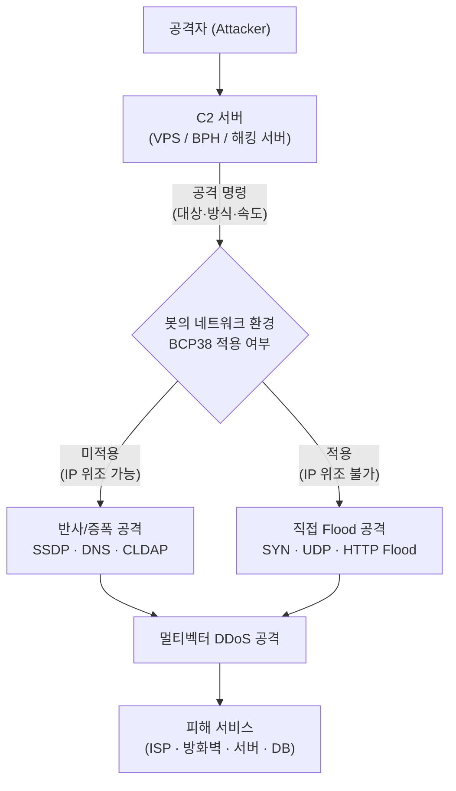

# 2026년 DDoS 공격 동향 레포트 (수정·보완판)

> 기존에 작성했던 레포트를 최신 자료와 공신력 있는 수치(CISA, Cloudflare 등)로 **사실 검증·수정**한 글입니다. 바뀐 부분은 본문 곳곳에 표시했고, 글 끝에 주요 수정 내역과 출처를 정리했습니다.

## 0. DDoS 증폭(반사) 공격이란?

**증폭(Amplification) 공격**은 공격자가 **출발지 IP를 피해자 IP로 위조(IP Spoofing)**한 작은 요청을 공개 서버(반사 서버)에 보내면, 서버가 **훨씬 큰 응답을 피해자에게** 보내도록 만드는 방식입니다. 작은 힘으로 큰 트래픽을 만들 수 있어 공격자가 선호합니다.

- **반사(Reflection):** 요청의 응답이 제3의 서버를 거쳐 피해자에게 향하게 하는 것.
- **증폭(Amplification):** 요청보다 응답이 훨씬 커서 트래픽이 부풀려지는 것.
- **증폭률(Amplification Factor):** 요청 대비 응답이 몇 배 커지는지를 나타내는 값.

## 1. 주요 증폭 공격 프로토콜과 증폭률

> ⚠️ **수정:** 기존 레포트의 증폭률 일부가 부정확하여, 미국 CISA가 공개한 참조 수치를 기준으로 **보정**했습니다. (특히 DNS는 기존 "x15~x22"로 적었으나, 공개 자료 기준 **약 28~54배**가 더 정확합니다.)

| 프로토콜 | 기본 포트 | 대상 장비 | 증폭률(대략) |
|----------|-----------|-----------|--------------|
| DNS | UDP/53 | Open Resolver | **약 28~54배** (ANY 질의 시) |
| NTP | UDP/123 | 구형 NTP 서버 | **최대 약 556배** (monlist 기능) |
| SSDP | UDP/1900 | UPnP 장비(IoT) | 약 30배 |
| CLDAP | UDP/389 | Active Directory | **약 56~70배** |
| SNMP | UDP/161 | Public Community 노출 장비 | 높음 (수~수백 배) |
| Memcached | UDP/11211 | 노출된 캐시 서버 | **최대 약 51,000배** (매우 높음) |
| CoAP | UDP/5683 | IoT 센서 | 중간 |
| TFTP | UDP/69 | 네트워크 장비 | 중간 |
| Portmap(RPCBind) | UDP/111 | Unix RPC 서비스 | 높음 |

> 📌 **보충:** 증폭률은 **서버 설정에 따라 편차가 매우 큽니다.** CMU의 측정 연구(AMPMap)에 따르면, 하나의 대표값으로 위험을 추정하면 실제와 크게 어긋날 수 있습니다. 따라서 위 수치는 **"대략의 기준"**으로만 이해하는 것이 좋습니다.

### 증폭률이 아니라 "패킷 수"가 문제인 경우
SSDP는 증폭률 자체는 낮지만, **초당 패킷 수(PPS)가 매우 높아** 방어 장비에 부담을 줍니다. 즉 증폭 공격은 **대역폭(Gbps)**과 **패킷 수(Mpps)**라는 두 축으로 나눠서 봐야 합니다.

## 2. 주요 DDoS 증폭 국가 (반사 서버가 많은 국가)

반사 서버는 **보안 설정이 미흡한 공개 장비**가 많은 곳에 집중됩니다.

- **미국:** 가장 많은 인터넷 자산(IP)을 보유해 반사 서버 수도 지속적으로 상위권입니다.
- **중국:** IoT 장비와 Open Resolver가 여전히 많아 노출 장비가 많습니다. (※ 기존 레포트에는 "만리장성 때문에 별로"라고 적혀 있었으나, 이는 **외부로 나가는 공격 트래픽**에 대한 설명일 뿐, **반사 장비 자체는 많다**는 점을 구분해야 합니다.)
- **베트남:** SSDP 및 CoAP에 노출된 장비가 증가하고 있습니다.
- **대한민국:** 공인 IP를 쓰는 CCTV, NAS, 공유기 등의 영향으로 SSDP 반사 서버가 꾸준히 발견됩니다.
- **인도·브라질:** 지역 ISP 비중이 높고 Rate Limit·필터링이 미흡한 Open Resolver가 많습니다.
- **일반 경향:** 인터넷이 빠르게 보급되는 개발도상국일수록 **취약 장비의 밀도가 높은** 경향이 있습니다.

## 3. Mirai 봇넷 (2026년 현황)

Mirai는 **2016년 소스코드가 공개된 이후**, 수백 개의 변종으로 퍼진 대표적인 IoT 봇넷입니다.

> 📌 **보충(최신 수치):** 2025~2026년 보안 보고서에 따르면 Mirai 계열은 **116종 이상의 변종, 2만 1천 개 이상의 샘플**로 확장된 것으로 분석됩니다. 2025년 초 Cloudflare는 Mirai 변종 봇넷이 일으킨 **약 5.6 Tbps 규모의 역대 최대급 DDoS 공격**을 보고하기도 했습니다.

### 대표 변종
Original Mirai, Mozi, Satori, Okiru, Mukashi, RapperBot, EnemyBot, Dark.IoT, 그리고 최근의 **Murdoc_Botnet(Avtech 카메라·Huawei 공유기 표적), Aisuru** 등이 있습니다.

### 주요 감염 대상
IP 카메라, DVR, NAS, 소형 공유기(SOHO Router), IoT 게이트웨이, 리눅스 임베디드 장비.

### 주요 공격 방식
UDP Flood, TCP SYN Flood, ACK Flood, GRE Flood, HTTP Flood, DNS Query Flood, Reflection 공격 등. 최근 변종은 **워치독 타이머를 꺼서** 장비가 과부하로도 재부팅되지 않게 만드는 기법까지 사용합니다.

## 4. 주요 반사 프로토콜 상세

### SSDP Reflection (UDP/1900)
- UPnP 서비스가 켜진 장비를 이용합니다.
- IoT 기기 증가로 꾸준히 악용되며, **Mirai 계열이 가장 많이 쓰는 반사 방식** 중 하나입니다.
- 주요 노출 국가: 베네수엘라, 중국, 알제리, 크로아티아, 대한민국, 베트남, 대만, 인도, 카자흐스탄.

### CLDAP Reflection (UDP/389)
- Active Directory 도메인 컨트롤러·LDAP 서버가 대상입니다.
- **증폭률이 56~70배로 높아** 기업망을 겨냥한 공격에 많이 쓰입니다.

### DNS Reflection (UDP/53)
- Open Resolver를 이용하며, **ANY 질의·DNSSEC·대형 TXT 레코드**로 응답을 키웁니다.
- DNSSEC가 켜진 서버일수록 응답이 커서 증폭률이 높습니다.
- 주요 국가: 방글라데시, 브라질, 인도.

### CoAP Reflection (UDP/5683)
- IoT 센서, 스마트 팩토리·스마트 홈·스마트 미터 장비가 대상입니다.
- 증폭률은 DNS보다 낮지만 **노출 장비 수가 많아** 공격 빈도가 늘고 있습니다.

### ESP Reflection (IP Protocol 50)
- IPSec/VPN 게이트웨이를 대상으로 하는 **비교적 새로운 벡터**입니다.
- VPN 장비 증가와 함께 관찰되며, 일반 UDP 반사보다 탐지가 어렵다는 특징이 있습니다. (※ 아직 사례가 많지 않은 **신흥 벡터**이므로, 자료가 제한적입니다.)

### 기타 관찰되는 프로토콜
NTP(UDP/123), Memcached(UDP/11211), WS-Discovery(UDP/3702), mDNS(UDP/5353), RIPv1(UDP/520), QUIC Reflection(UDP/443, 초기 핸드셰이크 악용 연구 단계).

## 5. 2026년 공격 트렌드

1. **Reflection + Botnet 혼합 공격** 증가
2. L3/L4 반사 공격 뒤에 HTTP Flood를 연결하는 **멀티벡터 공격**의 일반화
3. IoT 장비를 이용한 **SSDP·CoAP 공격** 지속 증가
4. VPN 장비를 이용한 **ESP Reflection** 증가
5. **DNSSEC를 이용한 고증폭 DNS Reflection** 지속
6. 공격 대상·프로토콜을 **자동으로 선택하는 자동화 봇넷** 사례 증가

## 6. IP Spoofing과 BCP38

증폭 공격의 전제 조건은 **출발지 IP 위조(IP Spoofing)**입니다. 이를 막는 표준이 **BCP38(송·수신 트래픽 필터링)**입니다.

> **BCP38이 적용된 네트워크에서는 IP 위조가 불가능**하므로, 반사·증폭 공격을 원천적으로 차단할 수 있습니다. 문제는 전 세계 일부 ISP가 아직 이를 적용하지 않는다는 점입니다.

### IP 위조가 가능한 인프라 (악용 수준)

| 인프라 | Spoofing 가능성 | 특징 |
|--------|-----------------|------|
| BCP38 미적용 ISP | 매우 높음 | 반사 공격의 핵심 인프라 |
| 불릿프루프 호스팅(BPH) | 높음 | 악용 신고 대응이 느림 |
| 중소 IDC | 높음 | ACL·필터링이 미흡한 사례 존재 |
| 교육기관 네트워크 | 중간 | 일부 연구망에서 검증 부족 |
| VPS | 낮음 | 대부분 차단, Flood 공격에는 활용 |
| 퍼블릭 클라우드(AWS·Azure·GCP) | 매우 낮음 | 출발지 검증 적용 |
| 가정용 ISP | 매우 낮음 | 대부분 uRPF·BCP38 적용 |

## 7. 반사 공격 vs 직접 공격 비교

| 구분 | 반사/증폭 공격 | 직접 Flood 공격 |
|------|----------------|-----------------|
| 출발지 IP 위조 | **필수** | 불필요 |
| BCP38 적용 영향 | 차단됨 | 영향 없음 |
| 주요 공격원 | 미적용 ISP·BPH·봇 | 봇넷·VPS·서버 |
| 공격 효율 | 매우 높음 | 봇 수·대역폭에 비례 |
| 주요 프로토콜 | DNS·SSDP·CLDAP·CoAP·NTP | TCP SYN·UDP·HTTP(S) |
| 탐지 난이도 | 높음 | 중간 |
| 주요 대응 | BCP38, 반사 서버 차단 | 스크러빙·WAF·Rate Limit |

## 8. DDoS 공격 절차 (흐름도)

> ⚠️ **수정:** 기존 레포트의 ASCII 도표가 깨져 있어, 아래와 같이 흐름도로 다시 정리했습니다.

## 9. 대응 방안

1. **UDP 기반 서비스 최소화** — 불필요한 UDP 서비스를 닫습니다.
2. **Open Resolver 제거** — DNS 서버가 외부 아무에게나 응답하지 않게 설정합니다.
3. **SNMP Community String 변경** — 기본값(`public`)을 바꾸고 가능하면 **v3**를 씁니다.
4. **SSDP/UPnP 비활성화** — 인터넷 쪽으로 노출되지 않게 합니다.
5. **CLDAP 외부 접근 차단** 및 **CoAP 인터넷 노출 금지**.
6. **BCP38(Ingress/Egress Filtering) 적용** — IP 위조를 근본적으로 차단합니다.
7. **Anycast 기반 DDoS 방어망 구축**으로 트래픽을 분산합니다.
8. **Rate Limit·ACL 적용**.
9. **ISP 연계 RTBH(블랙홀 라우팅)·FlowSpec 활용**.
10. **실시간 NetFlow/sFlow 기반 이상 트래픽 탐지**.

## 10. 반사 서버는 어떻게 발견될까? (방어자 관점)

공격자는 **Shodan·Censys** 같은 검색 엔진으로 SSDP·DNS 등 특정 프로토콜이 열린 장비를 찾고, 대규모 스캐너로 반사 서버 목록을 수집합니다. 이때 **기본 비밀번호(`public` 등)를 그대로 쓰는 취약 장비**가 주요 표적이 됩니다.

> 💡 **방어 관점의 교훈:** 즉, **내 장비가 인터넷에서 검색되는 순간 공격 인프라가 될 수 있습니다.** 따라서 ① 불필요한 포트를 닫고, ② 기본 비밀번호를 반드시 바꾸고, ③ Shodan 등에서 **내 공인 IP가 어떻게 노출되는지 스스로 점검**하는 것이 중요합니다. (※ 본 글은 방어 목적의 개념 설명이며, 공격용 스캔 명령어는 다루지 않습니다.)

---

## 📌 주요 수정·보완 내역

1. **DNS 증폭률 수정:** 기존 "x15~x22" → **약 28~54배**(CISA 기준).
2. **NTP 수치 보강:** monlist 기능 증폭률이 **최대 약 556배**임을 명시.
3. **Memcached 수치 명확화:** "수만 배" → **최대 약 51,000배**로 구체화.
4. **중국 설명 보정:** "만리장성 때문에 별로" → **외부 공격 트래픽과 반사 장비 수는 다른 문제**임을 구분.
5. **2025~2026 최신 동향 추가:** Mirai 변종 116종 이상, Cloudflare 보고 역대 최대 5.6 Tbps 공격, Murdoc_Botnet·Aisuru 등.
6. **깨진 ASCII 도표를 흐름도로 교체.**
7. **공격용 스캔 명령어 삭제** 후, 동일 내용을 **방어 관점**으로 재서술.

## 참고 자료
- [CISA — UDP-Based Amplification Attacks (TA14-017A)](https://www.cisa.gov/ncas/alerts/TA14-017A)
- [CMU AMPMap 연구 논문](https://users.ece.cmu.edu/~vsekar/assets/pdf/sec21_ampmap.pdf)
- [DDoS Amplification — IXP 관점 측정 연구](https://ar5iv.labs.arxiv.org/html/2103.04443)
- [Help Net Security — Mirai가 일으킨 역대 최대 DDoS 공격 (2025)](https://www.helpnetsecurity.com/2025/01/22/mirai-ddos-botnets-iot/)
- [Hackread — Mirai 변종 수백 종으로 확산](https://hackread.com/mirai-malware-variants-botnet-growth/)
- [A10 Networks — 반사·증폭 DDoS 방어](https://www.a10networks.com/blog/how-defend-against-amplified-reflection-ddos-attacks/)
