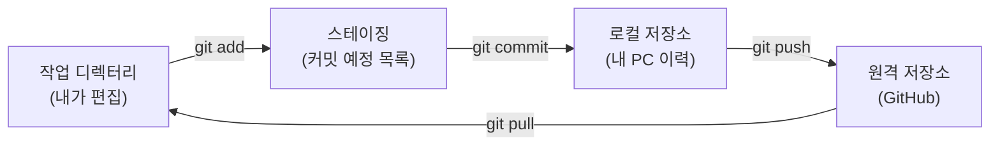
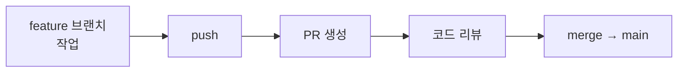

Git은 명령어 몇 개만 외워도 당장 쓸 수는 있지만, 각 명령이 무엇을 왜 하는지 모르면 충돌이나 되돌리기 상황에서 금방 막힙니다. 이 글은 처음 Git을 쓰거나 팀 작업 규칙을 정리하고 싶은 사람을 위해, 명령을 나열하는 대신 그 동작의 의미까지 함께 설명합니다.

## 1. 큰 그림 — 코드가 머무는 네 공간

Git을 이해하는 가장 빠른 길은 코드가 머무는 네 개의 공간을 아는 것입니다.



- **작업 디렉터리**: 지금 내가 파일을 편집하는 공간.
- **스테이징(staging)**: 이번 커밋에 포함할 변경을 담아 두는 임시 바구니.
- **로컬 저장소**: 내 PC에 쌓이는 커밋 이력.
- **원격 저장소(GitHub)**: 팀이 공유하는 온라인 저장소.

`add → commit → push`로 이어지는 이 흐름만 머리에 그려 두면 나머지는 대부분 응용입니다.

## 2. 프로젝트 가져오기 (clone)

```bash
git clone <저장소주소>        # 원격 프로젝트를 내 PC로 복사
cd <폴더명>                   # 복제된 폴더로 이동
git checkout -b <브랜치명>     # 새 브랜치를 만들고 그 브랜치로 이동
```

브랜치(branch)는 작업의 갈래입니다. 기능마다 갈래를 따로 만들어 작업한 뒤 합치면 서로의 작업이 섞이지 않습니다. 작업은 항상 기능별 브랜치에서 하는 것이 좋습니다.

원격에 이미 있는 브랜치를 가져오려면 이렇게 합니다.

```bash
git fetch origin                               # 원격 정보 가져오기
git checkout -b <브랜치명> origin/<브랜치명>     # 원격 브랜치를 로컬로 가져와 이동
```

## 3. 변경하고 올리기 (add → commit → push)

```bash
git status                     # 지금 무엇이 바뀌었는지 확인
git add .                      # 바뀐 파일을 스테이징에 모두 추가
git commit -m "feat: 로그인 기능 구현"   # 변경을 이력으로 기록
git push -u origin <브랜치명>   # 원격 저장소에 업로드
```

`-u origin <브랜치명>`은 최초 한 번만 입력하면 되고, 이후에는 `git push`만 쳐도 됩니다. `git add .`은 모든 변경을 담으므로, 일부만 담고 싶으면 `git add <파일명>`을 씁니다. `git status`는 자주 확인할수록 실수를 줄여 줍니다.

## 4. 가져와서 합치기 (fetch / pull)

```bash
git fetch origin     # 원격의 변경을 "가져오기만" (내 코드엔 아직 반영 안 함)
git branch -r        # 원격 브랜치 목록 보기
git pull             # 현재 브랜치에 연결된 원격 변경을 "가져와서 합치기"
```

`fetch`는 가져오기만 하고, `pull`은 가져와서 합치기까지 합니다. 협업 중에는 작업을 시작하기 전에 `git pull`로 최신 상태를 맞추는 습관이 충돌을 크게 줄여 줍니다.

## 5. 충돌(conflict) 해결하기

여러 명이 같은 파일의 같은 부분을 고치면 Git이 자동으로 합치지 못해 충돌이 납니다. 충돌이 난 파일을 열면 이렇게 표시됩니다.

```text
<<<<<<< HEAD
내 코드 (현재 브랜치)
=======
상대방 코드 (가져온 브랜치)
>>>>>>> feature/login
```

해결 순서는 다음과 같습니다. 먼저 `<<<<<<<`, `=======`, `>>>>>>>` 표시를 보며 어떤 코드를 남길지(내 것, 상대 것, 또는 둘을 합친 것) 결정합니다. 그다음 세 표시 줄을 모두 지우고 최종 코드만 남긴 뒤, 해결한 파일을 다시 올립니다.

```bash
git add <충돌해결한파일>
git commit              # 충돌 해결 커밋 (메시지는 자동 제안됨)
```

## 6. 되돌리기 — reset · revert · restore · stash

Git에서 가장 헷갈리는 부분입니다. 상황별로 정리합니다.

| 상황 | 명령 | 설명 |
|------|------|------|
| 아직 커밋 안 한 변경을 버리고 싶다 | `git restore <파일>` | 파일을 마지막 커밋 상태로 되돌림 |
| 스테이징만 취소하고 싶다 | `git restore --staged <파일>` | `add`를 취소(변경 내용은 유지) |
| 방금 한 커밋을 취소(이력에서 지움) | `git reset --soft HEAD~1` | 커밋만 취소, 변경은 스테이징에 남김 |
| 작업을 잠깐 치워 두고 싶다 | `git stash` / `git stash pop` | 임시 보관 / 다시 꺼내기 |
| 이미 push한 커밋을 안전하게 되돌린다 | `git revert <커밋>` | 되돌리는 새 커밋을 만듦(이력 보존) |

한 가지 주의할 점이 있습니다. 이미 원격에 push해 남들과 공유된 커밋은 `reset`으로 지우지 말고 `revert`로 되돌려야 합니다. 공유된 이력을 강제로 바꾸면 그 브랜치를 쓰는 다른 사람들의 저장소가 꼬입니다.

## 7. .gitignore — 올리면 안 되는 파일 제외

빌드 결과물, 비밀 키, 의존성 폴더 등은 저장소에 올리지 않습니다. 프로젝트 루트에 `.gitignore` 파일을 만들어 지정합니다.

```text
node_modules/
dist/
.env            # API 키·비밀번호가 든 파일은 올리지 않는다
*.log
```

특히 `.env`처럼 비밀값이 든 파일은 반드시 `.gitignore`에 넣어야 합니다. 한 번 push되면 이력에 영구히 남아, 나중에 지워도 과거 커밋에서 복원할 수 있기 때문입니다.

## 8. Pull Request로 코드 합치기

작업을 마치면 바로 합치지 않고 Pull Request(PR)를 만들어 리뷰를 받은 뒤 병합합니다.



PR 설명에는 무엇을 구현했는지, 어떻게 테스트했는지, 변경 사항은 무엇인지를 적습니다. 리뷰어가 한눈에 이해할 수 있도록 구체적으로 쓰는 편이 리뷰를 빠르게 합니다.

## 9. 커밋 메시지 규칙

"종류: 내용" 형식으로 쓰면 이력을 알아보기 쉽습니다.

| 종류 | 의미 | 예시 |
|------|------|------|
| `feat` | 새 기능 | `feat: 일정 반복 기능 구현` |
| `fix` | 버그 수정 | `fix: 일정 삭제 오류 수정` |
| `docs` | 문서만 수정 | `docs: README 업데이트` |
| `style` | 포맷·들여쓰기 등 | `style: 들여쓰기 수정` |
| `refactor` | 동작 그대로, 구조 개선 | `refactor: Calendar 정리` |
| `test` | 테스트 추가·수정 | `test: Calendar 테스트 추가` |
| `chore` | 빌드·설정 변경 | `chore: package.json 업데이트` |

## 10. 브랜치 이름 규칙

브랜치는 `종류/이름` 형식으로 만듭니다.

```text
feature/auth-login
fix/calendar-delete-bug
refactor/calendar-component
docs/readme-update
```

## 11. 정리

몇 가지는 습관으로 굳혀 두면 협업이 한결 수월해집니다. `main`·`master` 브랜치에서 직접 작업하지 않고 항상 기능 브랜치를 만들어 작업하기, 작업 시작 전에 `git pull`로 최신 상태 맞추기, 새 기능에는 README로 실행법과 사용 예시 남기기 — 팀원 모두가 이 정도만 지켜도 충돌이 줄고 이력 추적이 쉬워집니다.

## 참고 자료
- [Pro Git 한국어판 (공식 무료 전자책)](https://git-scm.com/book/ko/v2)
- [GitHub Docs — Pull Request](https://docs.github.com/ko/pull-requests)
