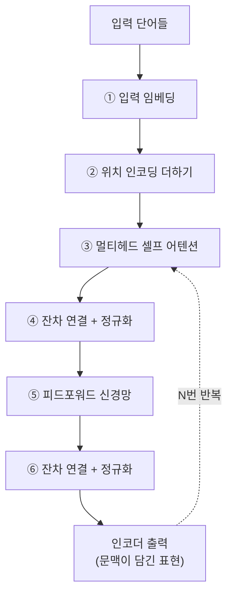
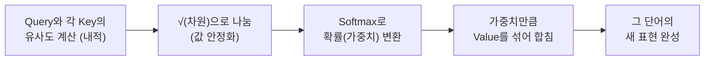
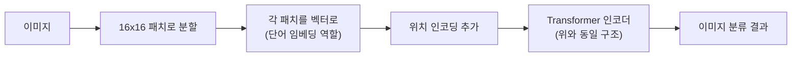

> **주제**: Transformer 논문 **"Attention Is All You Need"**의 **인코더** 부분을 그림과 비유로 이해합니다.
>
> 📎 **용어 정리**: "Attention Is All You Need"(2017)는 **Transformer**를 처음 제안한 논문이고, 흔히 함께 언급되는 **ViT(Vision Transformer)**는 그 인코더를 이미지에 적용한 후속 연구입니다. ViT의 뿌리가 이 인코더이므로, 여기서는 **인코더의 원리**를 중심으로 설명합니다.

## 1. 인코더가 하는 일 (한 문장)

> **인코더는 입력(문장 또는 이미지 조각)을, "문맥 정보가 녹아든 숫자 표현"으로 바꾸는 장치입니다.**

예를 들어 "그 **배**가 맛있다"와 "그 **배**가 항구에 있다"에서 같은 단어 "배"는 뜻이 다릅니다. 인코더는 **주변 단어를 함께 살펴서** 같은 단어라도 **문맥에 맞는 의미**를 담은 숫자로 바꿉니다.

## 2. 인코더의 전체 구조

인코더는 아래 블록이 **N번 쌓인(stack)** 형태입니다. (논문에서는 6번)

## 3. 단계별 설명

### ① 입력 임베딩 (Embedding)
컴퓨터는 글자를 모릅니다. 각 단어를 **숫자 묶음(벡터)**으로 바꿉니다. 비슷한 뜻의 단어는 비슷한 벡터를 갖도록 학습됩니다.

### ② 위치 인코딩 (Positional Encoding)
Transformer는 단어를 **한꺼번에** 처리해, 그냥 두면 **순서를 모릅니다.** "나는 너를 좋아해"와 "너를 나는 좋아해"를 구분하지 못하죠. 그래서 각 단어의 **위치 정보**를 임베딩에 더합니다. 논문은 **사인·코사인 함수**로 위치마다 고유한 값을 만들어 더합니다.

### ③ 멀티헤드 셀프 어텐션 — 인코더의 심장

가장 핵심입니다. **셀프 어텐션**은 **"문장 속 각 단어가 다른 모든 단어를 얼마나 참고할지"**를 계산합니다. 이를 위해 단어마다 세 벡터를 만듭니다. 도서관으로 비유하면,

| 이름 | 역할 | 비유 |
|------|------|------|
| **Query(질문)** | 내가 찾는 것 | "나는 어떤 정보가 필요하지?" |
| **Key(열쇠)** | 각 단어의 꼬리표 | 책마다 붙은 주제 라벨 |
| **Value(값)** | 실제 정보 | 책의 내용 |

작동 순서(**스케일드 닷-프로덕트 어텐션**):

- **유사도(내적)**: Query와 Key가 비슷할수록 큰 값 → "이 단어를 많이 참고하라".
- **√(차원)으로 나누기**: 차원이 크면 내적 값이 지나치게 커져 Softmax가 한쪽으로 쏠립니다. 이를 완화해 **학습을 안정화**합니다.
- **Softmax**: 유사도를 **합이 1인 가중치**로 바꿉니다.
- **Value 가중합**: 가중치만큼 각 단어의 정보를 섞어 새 표현을 만듭니다.

이렇게 "배"라는 단어가 주변의 "맛있다" 또는 "항구"를 **스스로 참고**해 의미를 결정합니다.

**멀티헤드(Multi-Head)**란 이 어텐션을 **여러 개(예: 8개) 동시에** 수행하는 것입니다. 각 헤드가 서로 다른 관점(문법·의미 관계)을 보기 때문에 더 풍부하게 문맥을 파악합니다.

### ④·⑥ 잔차 연결 + 정규화 (Add & Norm)
- **잔차 연결(Add)**: 층을 거친 결과에 **들어가기 전 값을 다시 더합니다.** 정보 손실을 막고 깊은 신경망 학습을 안정시킵니다.
- **층 정규화(Norm)**: 값 분포를 고르게 맞춰 학습을 빠르고 안정적으로 만듭니다.

### ⑤ 피드포워드 신경망 (Feed-Forward)
어텐션으로 "주변을 참고한" 각 단어 표현을 **단어마다 독립적으로 한 번 더 가공**하는 작은 신경망입니다. 어텐션이 "정보를 모으는 단계"라면, 이 부분은 "모은 정보를 소화하는 단계"입니다.

## 4. 왜 이 구조가 강력한가

1. **문맥을 직접 본다**: 각 단어가 **모든 단어를 한 번에** 참고해, 멀리 떨어진 관계도 잘 잡습니다.
2. **병렬 처리 가능**: 순서대로가 아니라 **동시에** 계산해 학습이 매우 빠릅니다(RNN 대비 큰 장점).
3. **쌓을수록 깊어진다**: 블록을 겹치면 점점 추상적인 의미를 파악합니다.

## 5. ViT로의 연결

ViT는 **이미지를 작은 조각(패치)으로 자른 뒤**, 각 조각을 "단어"처럼 취급해 **똑같은 인코더에 넣습니다.**

즉 **"문장 속 단어들이 서로를 참고하듯, 이미지 속 조각들이 서로를 참고한다"**가 ViT의 핵심입니다. 이 인코더를 이해하면 ViT도 자연스럽게 이해됩니다.

## 6. 정리

- 인코더 = **입력을 "문맥이 담긴 숫자 표현"으로 바꾸는 장치.**
- 핵심은 **셀프 어텐션(Query·Key·Value + 스케일드 닷-프로덕트)** — 각 단어가 다른 단어를 **스스로 참고**합니다.
- **멀티헤드**로 여러 관점을 보고, **Add & Norm**으로 안정적으로 깊게 쌓습니다.
- 이 구조를 **이미지에 적용한 것이 ViT**입니다.

## 참고 자료
- Vaswani et al., "Attention Is All You Need" (2017) — [arXiv:1706.03762](https://arxiv.org/abs/1706.03762)
- Dosovitskiy et al., "An Image Is Worth 16x16 Words (ViT)" (2020) — [arXiv:2010.11929](https://arxiv.org/abs/2010.11929)
- [The Illustrated Transformer (Jay Alammar)](https://jalammar.github.io/illustrated-transformer/)
