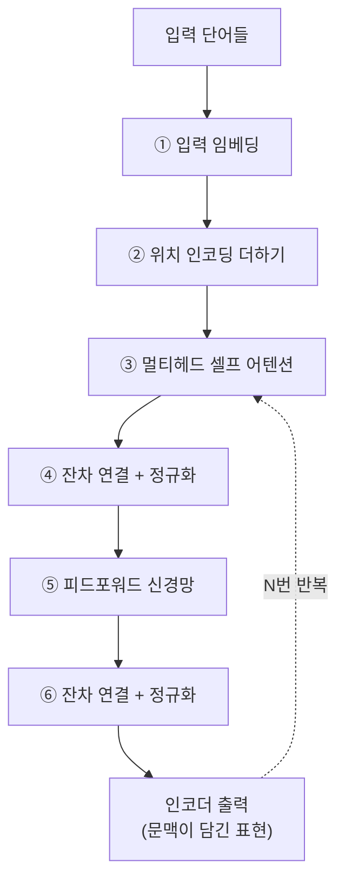
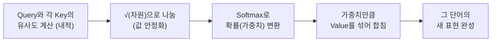
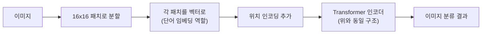

이 글은 2017년 논문 Attention Is All You Need가 제안한 Transformer의 인코더 부분을 그림과 비유로 풀어 봅니다. 흔히 함께 언급되는 ViT(Vision Transformer)는 이 인코더를 이미지에 적용한 후속 연구이므로, 여기서 인코더의 원리를 잡아 두면 ViT도 자연스럽게 이해됩니다.

## 1. 인코더가 하는 일

한마디로, 인코더는 입력(문장 또는 이미지 조각)을 문맥 정보가 녹아든 숫자 표현으로 바꾸는 장치입니다.

예를 들어 "그 배가 맛있다"와 "그 배가 항구에 있다"에서 같은 단어 "배"는 뜻이 다릅니다. 인코더는 주변 단어를 함께 살펴서, 같은 단어라도 문맥에 맞는 의미를 담은 숫자로 바꿉니다.

## 2. 인코더의 전체 구조

인코더는 아래 블록이 여러 번 쌓인 형태입니다(논문에서는 6번).

## 3. 단계별 설명

**① 입력 임베딩(embedding).** 컴퓨터는 글자를 모르므로, 각 단어를 숫자 묶음(벡터)으로 바꿉니다. 비슷한 뜻의 단어는 비슷한 벡터를 갖도록 학습됩니다.

**② 위치 인코딩(positional encoding).** Transformer는 단어를 한꺼번에 처리하기 때문에, 그냥 두면 순서를 모릅니다. "나는 너를 좋아해"와 "너를 나는 좋아해"를 구분하지 못하는 것입니다. 그래서 각 단어의 위치 정보를 임베딩에 더합니다. 논문은 사인·코사인 함수로 위치마다 고유한 값을 만들어 더합니다.

**③ 멀티헤드 셀프 어텐션.** 인코더에서 가장 중요한 부분입니다. 셀프 어텐션은 "문장 속 각 단어가 다른 모든 단어를 얼마나 참고할지"를 계산합니다. 이를 위해 단어마다 세 개의 벡터를 만듭니다. 도서관에 비유하면 다음과 같습니다.

| 이름 | 역할 | 비유 |
|------|------|------|
| Query(질문) | 내가 찾는 것 | "나는 어떤 정보가 필요하지?" |
| Key(열쇠) | 각 단어의 꼬리표 | 책마다 붙은 주제 라벨 |
| Value(값) | 실제 정보 | 책의 내용 |

이 세 벡터로 작동하는 과정이 Scaled Dot-Product 어텐션입니다.

Query와 Key의 내적은 둘이 비슷할수록 커져서 "이 단어를 많이 참고하라"는 신호가 됩니다. 이 값을 √(차원)으로 나누는 이유는, 차원이 크면 내적 값도 지나치게 커져 Softmax가 한쪽으로 쏠리기 때문입니다. 나눠서 완화하면 학습이 안정됩니다. Softmax는 이 유사도를 합이 1인 가중치로 바꾸고, 그 가중치만큼 각 단어의 Value를 섞어 새 표현을 만듭니다. 이렇게 "배"라는 단어가 주변의 "맛있다"나 "항구"를 스스로 참고해 의미를 정합니다.

멀티헤드(multi-head)는 이 어텐션을 여러 개(예: 8개) 동시에 수행하는 것입니다. 각 헤드가 서로 다른 관점(문법 관계, 의미 관계 등)을 보기 때문에 문맥을 더 풍부하게 파악합니다.

**④·⑥ 잔차 연결 + 정규화(Add & Norm).** 잔차 연결은 층을 거친 결과에 그 층에 들어가기 전 값을 다시 더하는 것으로, 정보 손실을 막고 깊은 신경망의 학습을 안정시킵니다. 층 정규화는 값 분포를 고르게 맞춰 학습을 빠르고 안정적으로 만듭니다.

**⑤ 피드포워드 신경망(feed-forward).** 어텐션으로 주변을 참고한 각 단어의 표현을, 단어마다 독립적으로 한 번 더 가공하는 작은 신경망입니다. 어텐션이 정보를 모으는 단계라면, 이 부분은 모은 정보를 소화하는 단계에 해당합니다.

## 4. 왜 이 구조가 강력한가

각 단어가 모든 단어를 한 번에 참고하므로 멀리 떨어진 관계도 잘 잡습니다. 또 순서대로가 아니라 동시에 계산하므로 학습이 빠른데, 이는 단어를 차례로 처리하던 RNN 대비 큰 장점입니다. 그리고 블록을 겹쳐 쌓을수록 점점 추상적인 의미를 파악합니다.

## 5. ViT로의 연결

ViT는 이미지를 작은 조각(패치)으로 자른 뒤, 각 조각을 단어처럼 취급해 똑같은 인코더에 넣습니다.

문장 속 단어들이 서로를 참고하듯 이미지 속 조각들이 서로를 참고한다는 것이 ViT의 핵심입니다. 인코더를 이해하면 ViT도 같은 원리의 적용으로 보입니다.

## 6. 정리

- 인코더는 입력을 문맥이 담긴 숫자 표현으로 바꾸는 장치입니다.
- 핵심은 셀프 어텐션(Query·Key·Value와 Scaled Dot-Product)으로, 각 단어가 다른 단어를 스스로 참고합니다.
- 멀티헤드로 여러 관점을 보고, Add & Norm으로 안정적으로 깊게 쌓습니다.
- 이 구조를 이미지에 적용한 것이 ViT입니다.

## 참고 자료
- Vaswani et al., "Attention Is All You Need" (2017) — [arXiv:1706.03762](https://arxiv.org/abs/1706.03762)
- Dosovitskiy et al., "An Image Is Worth 16x16 Words (ViT)" (2020) — [arXiv:2010.11929](https://arxiv.org/abs/2010.11929)
- [The Illustrated Transformer (Jay Alammar)](https://jalammar.github.io/illustrated-transformer/)
